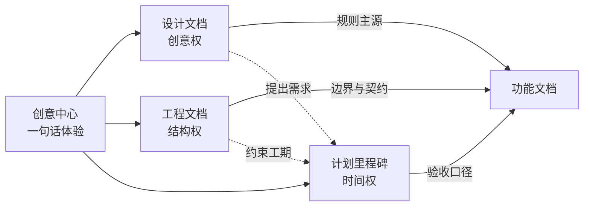
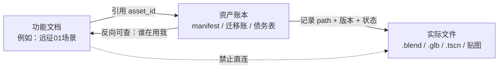

# 创作链路 · 五层结构大纲

> 版本：2026-10-20 草案（大纲，非定稿）
> 实例：ShellStorm2（`I:\工作项目\shellstrom2\ShellStorm2`）
> 配图：`创作链路_五层结构.png` / `.svg`（同目录）
> 关系说明：这是**项目怎么组织**的层级大纲；上一份《模块制作链路·工具·实用逻辑·评判维度》是**每个模块怎么造**。两份是纵轴与横轴，不重复。

---

## 0 一句话说清这套结构

**一条创意往下扩散成五层：创意本身 → 三份文档分权 → 三条最高原则 → 功能与模块文档 → 资产账本 → 制作流程。上一层不给下一层开门，下一层不许自己改上一层。**


---

## 1 总图（文字版，便于复制和改）

```
┌───────────────────────────────────────────────────────────────┐
│ 第 0 层  创意中心                                              │
│ 一句话：这个游戏给玩家的是什么体验                              │
└──────────────────────────┬────────────────────────────────────┘
                           │ 扩散（不是并列，是派生）
┌──────────────────────────┴────────────────────────────────────┐
│ 第 1 层  三份文档分权                                          │
│ ┌──────────┐  ┌──────────┐  ┌──────────────┐                  │
│ │ 设计文档  │  │ 工程文档  │  │ 计划/里程碑   │                  │
│ │ 创意权    │  │ 结构权    │  │ 时间权        │                  │
│ └──────────┘  └────┬─────┘  └──────────────┘                  │
└────────────────────┼──────────────────────────────────────────┘
                     │ 约束（工程文档内置三条最高原则）
┌────────────────────┴──────────────────────────────────────────┐
│ 第 2 层  最高原则（不可谈判）                                   │
│ ① 以版本文档为主轴  ② 功能解耦可独立维护  ③ 必须留工作日志        │
└──────────────────────────┬────────────────────────────────────┘
                           │ 分解
┌──────────────────────────┴────────────────────────────────────┐
│ 第 3 层  一个功能 = 一份独立文档                                │
│ 固定骨架：ID / 目标 / 规则 / 数据链 / 接口 / 失败收口 / 验收     │
└──────────────────────────┬────────────────────────────────────┘
                           │ 拆分 + 记账
┌──────────────────────────┴────────────────────────────────────┐
│ 第 4 层  模块文档 + 资产账本                                    │
│ 场景大模块 → 01/02/99 各一份    清单 / 迁移账 / 债务表           │
│ 文档不直接指向文件，一律经账本中转                               │
└──────────────────────────┬────────────────────────────────────┘
                           │ 固化
┌──────────────────────────┴────────────────────────────────────┐
│ 第 5 层  制作流程与制作原则                                     │
│ 四问：输入什么 → 做哪些动作 → 产出什么 → 怎么判合格              │
└───────────────────────────────────────────────────────────────┘
```

---

## 2 第 0 层：创意中心

### 2.1 它是什么
一句话讲清「玩家在这游戏里做什么、爽在哪、为什么记得住」。**它不是一个文档，是所有文档的共同源头。**

### 2.2 判断标准
- 能用一句话说完，不需要解释背景
- 这句话能推出「要做什么」和「不做什么」
- 团队里任何人复述，意思不走样

### 2.3 Storm2 实例
核心体验可以压成一句：**带枪下塔、边走边做取舍（拿卡 / 拿枪 / 拿钱），活着撤出来才算数。**
这句话直接派生出后面所有东西：塔层结构（关卡）、命运卡三选（取舍）、枪械工坊（成长）、撤离结算（风险）。

### 2.4 反例（这套结构最怕的）
- 创意写成功能列表（"要有 8 种枪"不是创意）
- 创意和设计文档混在一份里，改玩法时顺手改结构

---

## 3 第 1 层：三份文档分权

三份文档不是"三种笔记"，是**三种权力**。任何一份越界，项目就会在某处失控。

| 文档 | 掌什么权 | 回答什么 | 写什么 | **不写什么** | Storm2 实例 |
|---|---|---|---|---|---|
| **设计文档** | 创意权 | 玩什么、为什么好玩 | 目标体验、规则、数值语义、失败语义 | 代码结构、排期、验收清单 | `docs/v0.1/design/`（43 篇）+ 旧主题 `01–18_*.md` 技术施工篇（41 篇在 v0.1 根） |
| **工程文档** | 结构权 | 怎么搭、谁拥有事实 | 模块边界、事实所有者、接口契约、三条最高原则 | 具体玩法数值、某次交付细节 | `docs/v0.1/MODULE_INDEX.md`（43,146 字符）、`02_技术架构总则.md`（12,491 字符）、`feature_registry.json`（39,571 字节） |
| **计划/里程碑** | 时间权 | 什么时候、怎么算完 | 阶段、依赖、验收口径、完成度、变更登记 | 设计规则、代码实现 | `docs/v0.1/audits/`（11 篇）、`12_全游戏完成度清单.md`（31,264 字符）、`docs/v0.2/PLAN.md` |

**分权的实际效果**：改玩法只动设计文档，改结构只动工程文档，改排期只动计划文档。三份互相引用，但**没有一份能同时改三件事**。



---

## 4 第 2 层：工程文档里的三条最高原则

这一层是主人明确指定的，写进工程文档，**高于任何单个功能的设计**。

### 4.1 原则一：以版本文档为主轴进行创作

| 项 | 内容 |
|---|---|
| 含义 | 所有创作挂在版本号下（v0.1 / v0.2…），版本是时间的容器，不是文件夹名字 |
| 为什么 | 没有版本主轴，文档会变成"最新覆盖旧的"，历史全部丢失，无法回答"当时为什么这么做" |
| 怎么落地 | 版本目录 + 变更登记只追加不覆盖 + **不轻易提升 `project.godot` 版本号** |
| Storm2 实证 | `docs/v0.1/` 与 `docs/v0.2/` 分离；`v0.2/PLAN.md` 明确"只登记、不定义、不提升 `project.godot` 版本号" |
| 反例 | 直接改 v0.1 文档覆盖旧结论；把新玩法塞进旧主题篇而不留痕 |

### 4.2 原则二：工程功能解耦，可独立维护和开发

| 项 | 内容 |
|---|---|
| 含义 | 一个功能能单独跑起来、单独验收、单独回滚，不靠"先玩到第 3 关才能测" |
| 为什么 | 解耦才有并行；不解耦则每次改动都要全流程回归，成本指数上升 |
| 怎么落地 | 模块目录隔离 + 独立入口（探针/最小场景）+ 全局单例只做总线不做业务 |
| Storm2 实证 | `src/` 24 个模块目录；**130+ 探针脚本**在 `tests/verification/` 可单跑；25 个 autoload 只做总线；`tools/probe_*.gd` 做参数扫描 |
| 反例 | 功能只能从主流程进入；一个模块直接改另一个模块的存档字段 |

### 4.3 原则三：必须留下工作日志

| 项 | 内容 |
|---|---|
| 含义 | 每一次施工都留一条可追溯记录：改了什么、基线是什么、证据在哪、剩什么没做 |
| 为什么 | 没有日志，三个月后没人能判断"这个数是调过的还是原生的" |
| 怎么落地 | 交付记录按日期追加 + 变更总账 + 单次任务日志三件套 |
| Storm2 实证 | `development/` **252 篇**交付记录；`CHANGELOG.md`；每条含功能 ID、代码基线、改动、测试结果、遗留项 |
| 反例 | 只在聊天里说"改好了"；截图不落盘；只写"已优化"不写优化前后数字 |

---

## 5 第 3 层：一个功能 = 一份独立文档

### 5.1 固定骨架（十一个字段，直接从 Storm2 规范抄）
1. `feature_id / module_id` — 稳定标识，不随显示名改
2. 版本 — 目标版本、设计修订号、首次实现版本、验证基线
3. 来源与状态 — 用户设计 / 工程补充、已实现 / 部分实现 / 已验收，分开写
4. 事实所有者 — 只有一处拥有最终写入权
5. 输入命令 — 参数、前置条件、幂等键、错误码
6. 输出事件/查询 — payload/schema、稳定 ID、产生时机、订阅者
7. 数据链 — 内容 ID → 运行实例 → 持久化字段 → UI/资产
8. 失败收口 — 输入无效、资源不足、实例化失败、写盘失败、重试与回滚
9. 独立开发入口 — 领域测试或替身、最小场景、允许依赖与禁止的反向访问
10. 正式接入 — 主入口中的具体操作路径
11. 验收 — 正常/拒绝/重试/读档路径，需要表现的必须给真实渲染证据

### 5.2 为什么必须"一功能一文档"
- 功能文档是**唯一的规则解释处**，代码只是它的实现
- 一功能多文档 = 规则有多个版本；一文档多功能 = 改 A 必伤 B
- 文档之间只能引用，不能复制结论

### 5.3 Storm2 实例（功能层清单，节选）
命运卡（FATE-RULES）、枪械工坊、武器改造台、关卡生成、战斗奖励与物品流转、怪物与 AI、叙事触发、基地经济与存档结算、UI/UX 全局、音频、性能与画质、剧情与角色。

---

## 6 第 4 层：模块文档 + 资产账本

### 6.1 功能下面还要再分（模块文档）
一个功能文档管规则，但具体载体必须各自独立：

| 功能 | 下的模块 | 每个模块要有 |
|---|---|---|
| 关卡场景 | 远征 01 / 远征 02 / 测试关卡 99 / Boss 房 02 | 独立设计文档 + 交付记录 + 场景契约 |
| 命运卡 | 卡池投放 / 经济报价 / 运行时桥接 / 收集 UI | 各自一份说明 + 数据文件 + 探针 |
| 资产 | 角色 / 怪物 / 场景组件 / 特效 / 道具 | 清单 + 迁移账 + 债务表 |

### 6.2 资产账本是唯一交点

**核心规则：功能文档指向账本，账本指向文件。文档不许直接写死文件路径。**



三层账本各管一件事：

| 账本 | 管什么 | Storm2 实例 |
|---|---|---|
| **清单** | 有哪些资产、当前版本、归属 | `asset_manifest.json` — 626 份 |
| **迁移账** | 从源到运行态搬了什么、改了什么、为什么 | `character_transfer_ledger*.json` — 34 份 |
| **债务表** | 已知不合规但暂不修的，带原因和期限 | `asset_runtime_naming_debt.json` |

### 6.3 为什么必须过账本
- 换模型时不改文档，只改账本里的版本号
- 查"谁在用这个资产"一条查询搞定
- 资产改名/删除有据可依，不会一改就崩一片

---

## 7 第 5 层：制作流程与制作原则

到最底层，才是"怎么做"。每一类东西都有自己的流程文档，统一回答四问：

```
输入什么  →  做哪些动作  →  产出什么  →  怎么判合格
   │            │              │             │
   │            │              │             └─ 验收：专项 / 真实渲染 / 完整工程 / 设备
   │            │              └─ 产物落到哪、叫什么、进哪个账本
   │            └─ 步骤顺序、每步工具、失败怎么退
   └─ 参考图、源文件、规范、上一版
```

Storm2 现成的流程文档（可直接当模板）：

| 对象 | 流程文档 | 体量 |
|---|---|---|
| 3D 场景 | `10.1_3D场景美术生产流程.md` | 15,183 字符 |
| 道具低模 | `10.2_道具低模美术生产流程.md` | 6,929 字符 |
| 角色与动作 | `16.1_角色美术制作与动作导入流程.md` | 56,927 字符 |
| 特效 | `14.6_特效系统与制作规范.md` | 102,545 字符 |
| 关卡白盒 | `05.2_关卡版图白盒与生成规范.md` | 57,187 字符 |
| 关卡生成 | `05_技术施工_关卡生成与爬楼.md` | 90,285 字符 |

---

## 8 门禁：每层什么时候算通过

| 层 | 进入条件 | 完成判据 | 谁能宣布通过 |
|---|---|---|---|
| 0 创意 | 有人提出想法 | 一句话能被复述且不走样 | 项目负责人 |
| 1 三份文档 | 创意确认 | 三份各自成立，互相引用不互相覆盖 | 负责人 + 主程 |
| 2 最高原则 | 工程文档建立 | 三条原则写进文档，且有落地检查项 | 主程 |
| 3 功能文档 | 功能进入排期 | 十一字段齐全，独立入口可跑 | 主程 + 提出人 |
| 4 模块与账本 | 功能拆出模块 | 每个模块有文档 + 账本条目可查 | 模块负责人 |
| 5 流程与原则 | 开始实际制作 | 四问齐全，验收四级口径明确 | 制作执行者 + 验收者 |

**越层禁令**：第 5 层不许改第 3 层的规则；第 4 层的账本不许绕过第 3 层文档直接新增功能。

---

## 9 Storm2 目录映射（这套结构现在落在哪）

| 层 | 实际路径 | 现状 |
|---|---|---|
| 0 创意 | 散落在 `design/` 各篇开头 | ⚠️ **没有单独一份"创意中心"文档** |
| 1 设计文档 | `docs/v0.1/design/`（43 篇）+ v0.1 根 41 篇技术施工 | ✅ 量大，但新旧两套主题并存 |
| 1 工程文档 | `MODULE_INDEX.md`（43k 字符）、`02_技术架构总则.md` | ✅ 有，且已按 FeatureID 组织 |
| 1 计划里程碑 | `audits/`（11 篇）、`12_全游戏完成度清单.md`、`v0.2/PLAN.md` | ✅ 有，但完成度清单与索引口径需对齐 |
| 2 最高原则 | `DOCUMENTATION_STANDARD.md` 第 1–4 节 | ✅ 三条都在，但未单独立为"最高原则"章节 |
| 3 功能文档 | `design/` 内按功能分篇 + `MODULE_INDEX` FeatureID | ✅ 基本齐 |
| 4 模块文档 | 场景各篇（远征01/02/Boss房02）、命运卡各篇 | ✅ 有，颗粒度不均 |
| 4 资产账本 | `assets/**/asset_manifest.json`（626）+ ledger（34） | ✅ 强，是这套结构里最成熟的一层 |
| 5 流程原则 | v0.1 根 `10.1 / 10.2 / 16.1 / 14.6 / 05.2` | ✅ 有，且极详细 |
| 日志 | `development/`（252 篇）+ `CHANGELOG.md` | ✅ 强 |

**结论：五层里四层已经有实物，缺的是第 0 层（创意中心单独成文）和第 2 层的"升格"（三条原则目前混在规范里，没有被供起来）。**

---

## 10 这份大纲当前的三处缺口

1. **创意中心没有独立文档** — 现在要读 43 篇设计文档才能拼出一句话，新人（包括未来的我）上手成本高。
2. **旧主题篇（v0.1 根 41 篇）与新 design 篇并存** — 同一规则可能有两处说法，`DOCUMENTATION_STANDARD` 已承认此事并给了迁移规则，但迁移未完成。
3. **模块文档颗粒度不均** — 远征 01 有独立设计+装配文档，测试关卡 99 只有设计表；命运卡四个模块里报价和经济有文档，UI 层没有独立文档。

---

## 11 待主人拍板的五个点

1. **创意中心要不要单独成文**（一页纸，放在 `docs/v0.1/` 根，名字如 `00_创意中心.md`）？
2. **三条最高原则要不要从 `DOCUMENTATION_STANDARD.md` 抽出来**，单独立一章放在 v0.1 根，作为全项目第一页？
3. **旧主题 41 篇**是继续保留为"技术施工篇"，还是分批并入 `design/`？
4. **模块文档的最低要求**定为几项（我建议：一份说明 + 一个账本条目 + 一个探针，三件齐才算有）？
5. **账本是否要求"反向索引"**（能查"这个文件被哪些功能引用"），还是只保留正向清单？

---

*整理：杰西卡　2026-10-20　实例机器：2 号机（SS-zhuangmenghong）*
