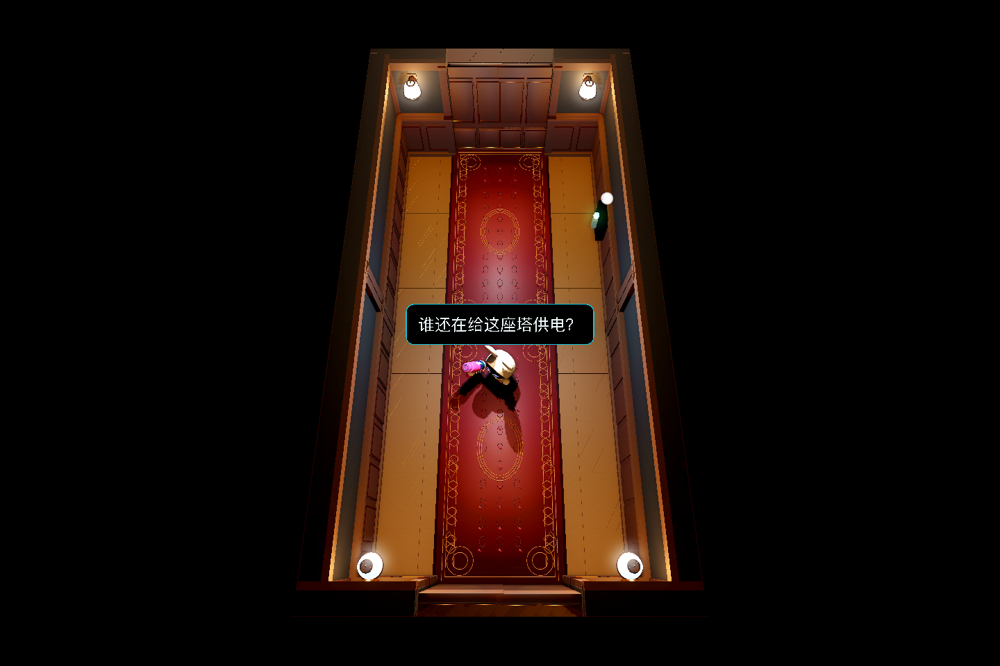
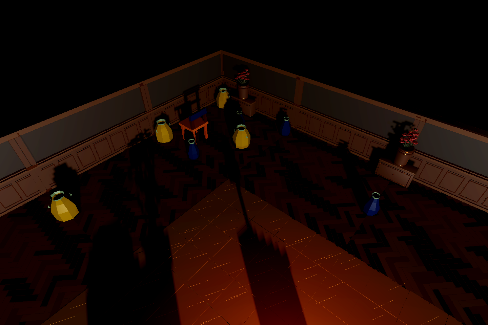

# 远征03顶灯模型与投影复核

[开发记录](../../v0.1/development/2026-11-01_exp03_light_shell_shadow.md)。种子1211616576，Mac M1/OpenGL Compatibility，真实关卡光照，无展示补光。测试逐房开启了灯作功能核查，图中不代表玩家存档灯态。

[恢复灯壳的同机位控制图](corridor_fixture_control.png)。仅隐藏顶灯CeilingMount/Fixture/Lens，不隐藏LampLight或开关；公馆台灯壁灯仍可见。

[同场景同相机关闭投影的控制图](shadow_off.png) / [正常游戏镜头](gameplay_shadow_on.png)。物件投影由室内Omni产生，顶部仍挡住太阳；未增加摄影棚光。当前阴影较硬，目标设备性能与阴影品质优化未在本轮签收。

[机器摘要](verification.json)：26个房间、26个顶灯，340项断言通过；开关能量、detail重建后仍隐藏灯壳、每房主光投影标记。阴影A/B像素变化单列，不拿headless替代画面验收。
