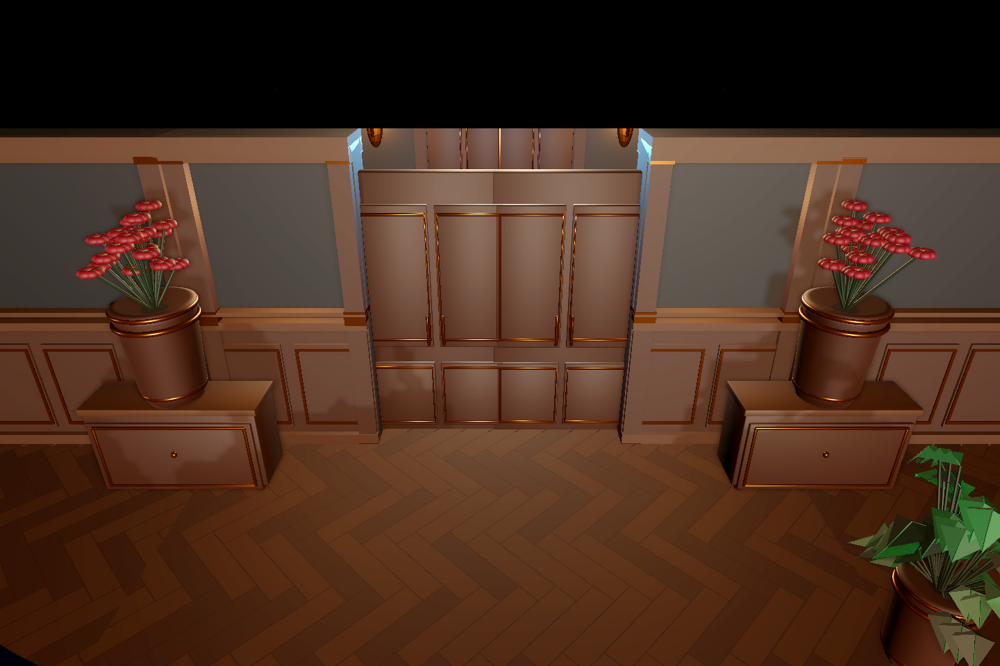

# 远征03黄铜实木门：实机验收

[开发记录](../../v0.1/development/2026-11-01_expedition03_manor_doors.md)。真实ExpeditionLevel03_3D，Mac M1/OpenGL Compatibility，既有公馆Prefab及正常游戏照明，无摄影棚补光。门框/墙和房内陈设保持，替换的是运行门扇外观。观察相机与正常游戏镜头分列；开门由玩家靠近触发，实际Player3D穿门后走远关闭。

旧装甲门：[北向观察图](old_north_closed.png)、[东向观察图](old_east_closed.png)。

新门：[北向关闭](manor_north_closed.png)、[北向打开](manor_north_open.png)、[东向关闭](manor_east_closed.png)、[东向打开](manor_east_open.png)。

正常游戏镜头：[北向](manor_north_gameplay.png)、[东向](manor_east_gameplay.png)。原模型正面为木面压线与黄铜装饰，背面为木面；未修改GLB、材质或追加装饰。

[机器摘要](verification.json)：6种子173门、远征01对照14门、真实几何/物理/感应/穿门/关闭检查；25份正式03布局与19份01运行TSCN哈希保留。未测试全部未来种子、Forward+或目标Windows性能，不提升整关完成状态。
