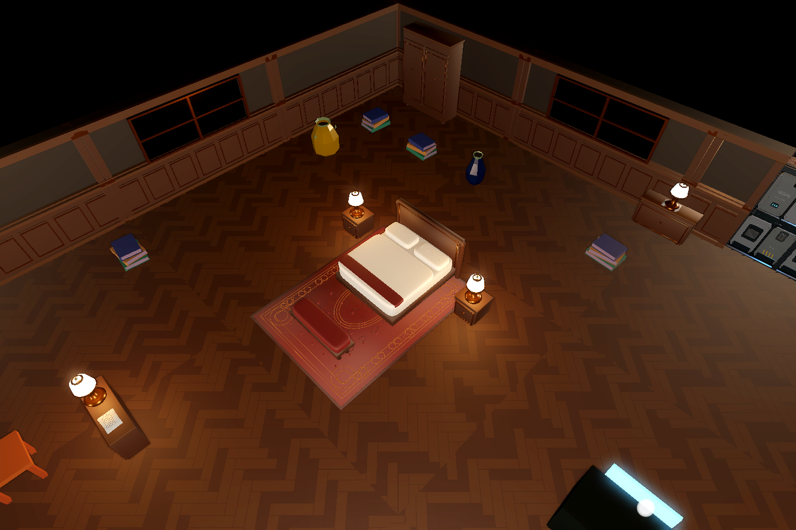
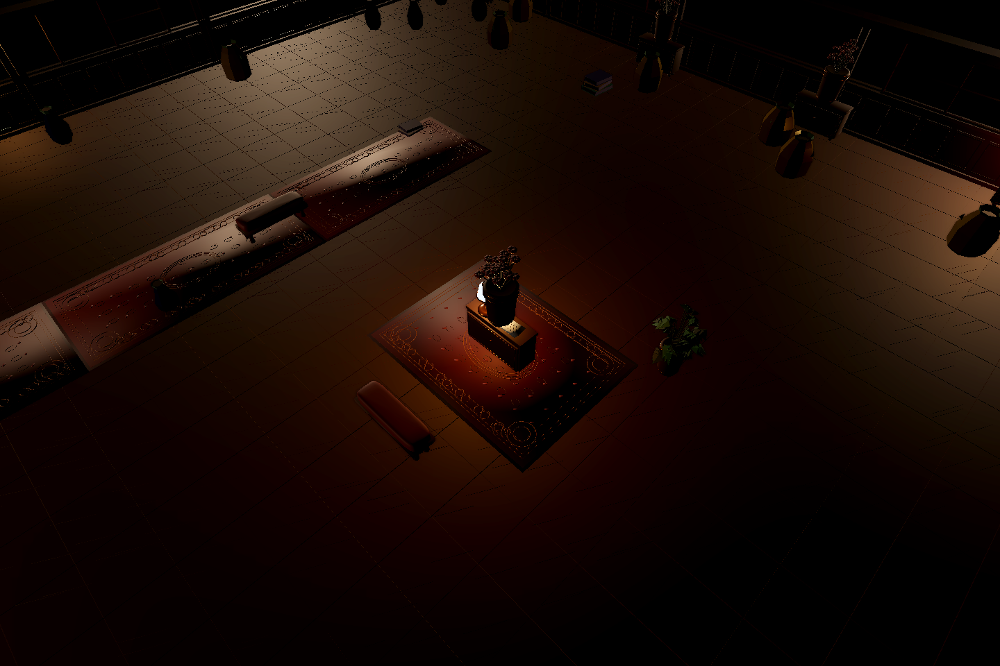
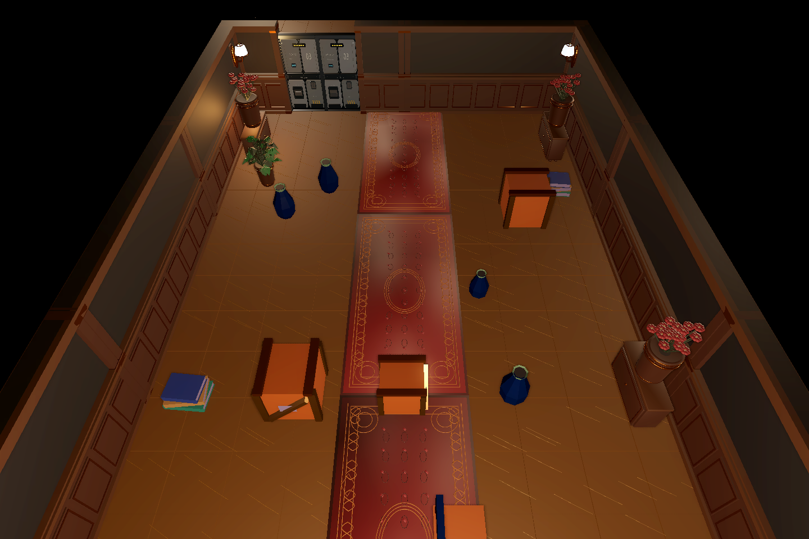

# 远征03其余房间与通道：游戏内画面

门扇后续已替换为公馆实木门，最新门外观见[门接入验收图集](../expedition03_manor_doors_20261101/README.md)；本页保留此前陈设验收时点画面。

对应[开发记录](../../v0.1/development/2026-11-01_remaining_themed_rooms.md)。使用正式ExpeditionLevel03_3D、Mac M1/OpenGL Compatibility真实渲染；地面、雾、作者灯和室内基础光为本轮正式表现，没有摄影棚补光。观察相机用于看设施组合，正常游戏镜头用于确认真实俯视可见。5m窄廊观察图使用正交相机；30×10连接房调整观察方向，修正早期相机落到幕墙外导致的全黑取景。

| 主题/尺寸m | 正式资源键 | 观察组合 | 正常镜头 |
|---|---|---|---|
| 仪式厅 50×40 | `boss_50x40_b7446dc46356_c6c134` | [观察相机](boss_50x40_b7446dc46356_c6c134_interior.png) | [正常游戏镜头](boss_50x40_b7446dc46356_c6c134_gameplay.png) |
| 更衣客房 25×25 | `upgrade_25x25_2154658c5c32_1b559c` | [观察相机](upgrade_25x25_2154658c5c32_1b559c_interior.png) | [正常游戏镜头](upgrade_25x25_2154658c5c32_1b559c_gameplay.png) |
| 档案过廊 30×10 | `room_30x10_cf3d5a630a1c_30c1c2` | [观察相机](room_30x10_cf3d5a630a1c_30c1c2_interior.png) | [正常游戏镜头](room_30x10_cf3d5a630a1c_30c1c2_gameplay.png) |
| 撤离候车厅 25×25 | `extraction_25x25_6f808c2e0839_ea81ed` | [观察相机](extraction_25x25_6f808c2e0839_ea81ed_interior.png) | [正常游戏镜头](extraction_25x25_6f808c2e0839_ea81ed_gameplay.png) |
| 行李搬运侧厅 25×25 | `combat_25x25_38083aa33b1a_897612` | [观察相机](combat_25x25_38083aa33b1a_897612_interior.png) | [正常游戏镜头](combat_25x25_38083aa33b1a_897612_gameplay.png) |
| 阅读回廊 30×40 | `combat_30x40_5fbbae7662fe_e86e98` | [观察相机](combat_30x40_5fbbae7662fe_e86e98_interior.png) | [正常游戏镜头](combat_30x40_5fbbae7662fe_e86e98_gameplay.png) |
| 宴会侧厅 40×30 | `combat_40x30_18c0881f3934_e86e98` | [观察相机](combat_40x30_18c0881f3934_e86e98_interior.png) | [正常游戏镜头](combat_40x30_18c0881f3934_e86e98_gameplay.png) |
| 长画廊 45×40 | `combat_45x40_6351962d84c2_007418` | [观察相机](combat_45x40_6351962d84c2_007418_interior.png) | [正常游戏镜头](combat_45x40_6351962d84c2_007418_gameplay.png) |
| 馆藏陈列室 40×30 | `event_40x30_24e9d88c229b_a653bb` | [观察相机](event_40x30_24e9d88c229b_a653bb_interior.png) | [正常游戏镜头](event_40x30_24e9d88c229b_a653bb_gameplay.png) |
| 物资整备库 40×30 | `scavenge_40x30_a0eceb3887c9_23641e` | [观察相机](scavenge_40x30_a0eceb3887c9_23641e_interior.png) | [正常游戏镜头](scavenge_40x30_a0eceb3887c9_23641e_gameplay.png) |
| 废弃宴席封锁厅 40×30 | `trap_40x30_29d67dbb9bda_d2426a` | [观察相机](trap_40x30_29d67dbb9bda_d2426a_interior.png) | [正常游戏镜头](trap_40x30_29d67dbb9bda_d2426a_gameplay.png) |
| 接待铺面 30×40 | `merchant_30x40_f2a374f5465f_d77c54` | [观察相机](merchant_30x40_f2a374f5465f_d77c54_interior.png) | [正常游戏镜头](merchant_30x40_f2a374f5465f_d77c54_gameplay.png) |
| 金边导引廊 5×5 | `room_5x5_e715d2f554c1_30c1c2` | [观察相机](room_5x5_e715d2f554c1_30c1c2_detail.png) | [正常游戏镜头](room_5x5_e715d2f554c1_30c1c2_gameplay.png) |
| 金边导引廊 5×10 | `room_5x10_d4a53812df19_30c1c2` | [观察相机](room_5x10_d4a53812df19_30c1c2_detail.png) | [正常游戏镜头](room_5x10_d4a53812df19_30c1c2_gameplay.png) |
| 金边导引廊 5×15 | `room_5x15_834885ac6f21_30c1c2` | [观察相机](room_5x15_834885ac6f21_30c1c2_detail.png) | [正常游戏镜头](room_5x15_834885ac6f21_30c1c2_gameplay.png) |
| 金边导引廊 10×5 | `room_10x5_33335543dae5_30c1c2` | [观察相机](room_10x5_33335543dae5_30c1c2_detail.png) | [正常游戏镜头](room_10x5_33335543dae5_30c1c2_gameplay.png) |
| 档案库 40×30 | `storage_40x30_ef3f827636f7_3e5f15` | [观察相机](storage_40x30_ef3f827636f7_3e5f15_interior.png) | [正常游戏镜头](storage_40x30_ef3f827636f7_3e5f15_gameplay.png) |
| 行李寄存间 25×25 | `storage_25x25_95769e85e209_3e5f15` | [观察相机](storage_25x25_95769e85e209_3e5f15_interior.png) | [正常游戏镜头](storage_25x25_95769e85e209_3e5f15_gameplay.png) |
| 清点工作间 25×25 | `scavenge_25x25_7fda840577df_23641e` | [观察相机](scavenge_25x25_7fda840577df_23641e_interior.png) | [正常游戏镜头](scavenge_25x25_7fda840577df_23641e_gameplay.png) |
| 档案过廊 10×30 | `room_10x30_a81bd0123e9c_30c1c2` | [观察相机](room_10x30_a81bd0123e9c_30c1c2_interior.png) | [正常游戏镜头](room_10x30_a81bd0123e9c_30c1c2_gameplay.png) |
| 封存警戒厅 25×25 | `trap_25x25_99212e763067_d2426a` | [观察相机](trap_25x25_99212e763067_d2426a_interior.png) | [正常游戏镜头](trap_25x25_99212e763067_d2426a_gameplay.png) |
| 金边导引廊 15×5 | `room_15x5_9c66fb907802_30c1c2` | [观察相机](room_15x5_9c66fb907802_30c1c2_detail.png) | [正常游戏镜头](room_15x5_9c66fb907802_30c1c2_gameplay.png) |

## 顶盖挡光控制组

以下仅额外添加一盏竖直方向光来验证投影开关，不能当正常游戏内灯光效果。相同ROI的平均亮度：关闭遮光体 0.555，开启 0.186，下降 66.4%。

[关闭遮光体](roof_control_off.png) / [开启遮光体](roof_control_on.png)。黑色模型仅投影，正常镜头仍能看到屋内；四壁与顶部不提供游戏碰撞。

## 破碎前、飞散、落定

[完整设施](combat_45x40_6351962d84c2_007418_facilities.png) / [真实弹道飞散](combat_45x40_6351962d84c2_007418_burst.png) / [碎片落定](combat_45x40_6351962d84c2_007418_broken.png)。17份有易碎件的资源均完成玩家武器/接触检查；5份窄廊没有易碎件。

## 原三房保持

三份TSCN文件和原账本行不变；新增全关遮光后正常镜头复核：[入口](preserved_stair_lobby_15x15_703e12bd9aa8_4955df.png)、[中房](preserved_event_25x25_ba83cdc666fb_a653bb.png)、[大堂](preserved_combat_45x40_6351962d84c2_68065f.png)。

大范围正交布局仅作空间参考：[仪式厅](boss_50x40_b7446dc46356_c6c134_layout.png)、[长画廊](combat_45x40_6351962d84c2_007418_layout.png)、[档案库](storage_40x30_ef3f827636f7_3e5f15_layout.png)。视角/雾与局部高光会影响整体读图，不取代上方正常镜头。原生截图保留现有玩家表现，未做图像修饰。

数量、文件与图像SHA、原生玩家结果、保护文件及受控挡光量化见[机器验收摘要](verification.json)。完整日志和原始截图保留工程外本次工作目录；未执行目标设备帧时预算、全进程通关及所有未来种子。
