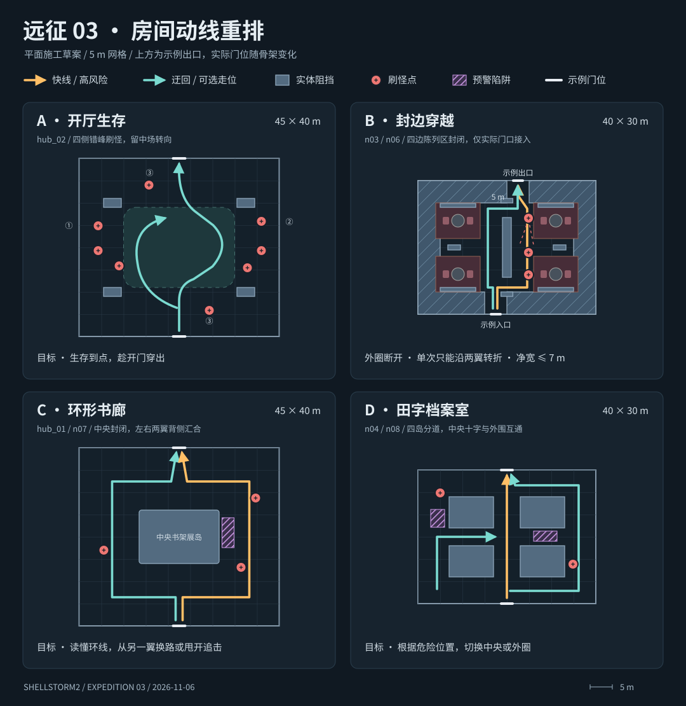

# 远征 03 房间动线重排

当前逐房制作分配见[房间类型制作计划](远征03房间类型制作计划.md)，该表按用户最新指定的正式房型维护；早期 n03/n06/hub_01/n04 节点草案不再充当施工清单。

关联 `WORLD-PLAN`。本稿以 2026-11-06 的正式房间池和六张 flow 为基准。当前已批准的工坊房型施工见下表；下方早期节点安排为目标草案。普通房的新刷怪、限时生存和零击杀离房仍是设计目标。

## 当前批准的工坊施工范围

用户最新红框优先于下方早期节点草案。正式 TSCN 是布局真源，直接维护场景工坊登记的组件实例，不从旧 Blender/JSON 重生成陈设。验证使用命令行和离屏渲染，不操作用户电脑界面。

| 工坊正式房型 | 当前空间要求 |
| --- | --- |
| 储藏房40×30m·储藏间 | C；书柜闭合围住中央档案区，外圈双向通行，原设施保留。 |
| 商店20×15m·铺面 | 补齐保存文件中的墙和地板，保留装修。编辑器预览壳体不与运行时实际门位壳体重复。 |
| 商店30×40m·铺面 | D；四个柜组岛保留中央十字与外圈，按红框补双门衣柜，柜门朝所在岛外侧；底边柜组避让本局真实门。 |
| 战斗房45×40m·大回廊 | C；外围护墙围住中央设施，原中央摆设保留；单一入口内的书柜可击倒，内设一只沿用现有开箱协议的普通宝箱。大堂为另一正式房型，不随本次改动。 |
| 搜索房40×30m·操作间 | B；以截图文件尺寸为准。中央主带约4m、净宽不超过7m，两侧支路有尽头；红框用护墙封闭，墙边补少量原风格陈设，外围原物件保留。 |
| 撤离房25×25m·撤离舱 | B；中央保留通行与撤离交互空间，不放中央大块家具；两侧候车陈设分隔成端口接入段，真实侧门连到中央通道。撤离机制及其所有者不变。 |
| 陷阱房40×30m·陷阱厅 | 用沙发、书柜和倒柜封闭图示两个区域，保留其余原设施及交互。 |

内部护墙标记 `authored_interior_structure`，由正式房间拥有；运行时仅按真实端口重建外围壳体，不删除内部作者围挡。新增边缘柜组中只有标记为端口避让候选的实例可按真实门前净空禁用，不移动原陈设。原可交互组件保留脚本、受击、倒塌与持久化行为。导航可走面以碰撞为依据，倒塌/破碎后复用已有刷新能力。宝箱标记只提供布局、稳定 ID 与现有奖励配置，奖励和开箱状态继续归现有房间/地牢协议。

## 从关卡出口倒推房间分工

玩家进房先辨认能去哪里，再决定抢近路、拉开距离，还是花时间打掉堵路的怪。房间大小给路线留空间，家具决定什么时候需要转向，刷怪决定哪条路眼下代价更高。Boss 与撤离的先后仍由关卡图表达。宝箱支路和商店的回报应能从门口读懂。

现行 flow 的 `NORMAL` 通常从四种壳体抽取，`n03` 固定 40×30 m、`n06` 固定 30×40 m，`HUB` 固定 45×40 m。敌群按节点选择，进房后在同一波生成。一个节点换了尺寸仍可能拿到同组敌人，房间陈设也没有对应不同出门目标。清怪才放行的规则让现有绕路只用于走位，无法直接穿房。重排时应把空间、敌群和出门规则放进同一个房间变体契约。

| 位置 | 当前 | 重排分工 |
| --- | --- | --- |
| `room_01`（首战，原 `n01`） | 多尺寸模板池，先教清怪 | 优先 25×25 m 教直穿。短直线和一个可看到汇合点的掩体绕路，出口可达即通过。 |
| `hub_01` | 45×40 m 多门大堂 | 环形枢纽。玩家沿入口灯带看到两翼，绕中央展岛后可转到不同房间。 |
| `hub_02` | 45×40 m 重编成枢纽 | 大厅生存原型。每条必经路线最多一间生存房，开局先给玩家辨方向的时间，结束后开向下一段的门。 |
| `n02`、`n03`、`n06` | 规格随池抽取，现有霰弹/冲撞编成有正面压力 | `n02` 保持 25×25 m 短穿越。`n03`、`n06` 已固定为 40×30 m / 30×40 m 穿越陈设。把冲撞朝向对准快线，把两次折返和侧翼视线让给绕行路线。 |
| `n04`、`n05` | 爆炸与法术编成，部分尺寸共用布局 | `n04` 40×30 m 田字房承接爆炸区封一条边的选择。`n05` 25×25 m 作为压力回落，布一组掩体，保两条短线。 |
| `n07`、`n08` | 商店前辅助班、部分 flow 才有的书怪战斗 | `n07` 45×40 m 环形书廊，短侧有护卫，长侧绕过。`n08` 40×30 m 田字档案室，远程和陷阱分开布。 |
| `conn_*`、注入房 | 窄长过道与秘密/壁炉房 | 连接房继续负责换方向和预告。秘密房和壁炉保留各自的发现价值，出口可在当前房间内辨认。 |
| `boss_foyer → boss → exit` | 整备、首领、撤离 | 25×25 m 前厅收束路线，金门成为唯一视觉焦点。Boss 50×40 m，出口舱 25×25 m。 |

每张 flow 先标最短合法撤离路径和一条可选搜刮路径。把生存压力放在长时间停留有意义的位置，其余节点用绕行耗时、遭遇角度和回报形成取舍。若 `hub_02` 位于可选翼，生存目标随这间房留在可选翼。图中从下进、向上出用于说明原型。实际端口随 flow 变动，各原型均须接通自己使用的门位。

现有大堂 `hub_01` 的接待柜、中央档案柜及两侧圆桌各有独立阻挡。环形版先把接待柜和书柜并成中央展岛，把两侧圆桌撤到不穿越的角落。`hub_02` 把长柜和零碎小件退到外围，在中场边缘布四组短掩体。`n03` 和 `n06` 的穿越版沿用公馆的圆桌对座、沙发会客、地毯和边柜台灯组合，以中央背靠背书架与四处阅览角组织路线。家具按正常使用关系摆放，书架背部与沙发背部参与阻挡，地毯只表达区域。

## 四张原型施工图

坐标以房心为原点，X 向右、Z 向下，范围为碰撞包络，单位 m。家具组可用多个可复用组件围出同一边界。路线净宽以实际碰撞面计，通行主带至少 3 m，外围绕行带至少 4 m。每个门位从洞口向内留 3 m 深的汇合区。首版秒数和怪物数量是白盒测试起点。

| 原型 | 阻挡与动线 | 刷新、离房和失败条件 |
| --- | --- | --- |
| A 开厅生存 · 45×40 | 中场保留约 25×18 m 连续走位面。四个 4×2 m 短掩体中心设在 `(±15, ±10)`，边缘始终能转向。 | 进房后 3 秒起从左右错开施压，首批 3 只、第二批 3 只、末段 2 只。按 30 秒生存起测，计时到即可离开，存活怪仍构成撤出压力。门灯显示倒计时阶段。若只需贴边无伤绕圈，先改刷新角度。 |
| B 折线穿越 · 40×30 | 中央背靠背书架分成两翼，四边用带装修的柜组封闭，真实门口由 5 m 接入段连到内侧路线。连续外圈和中央横穿均截断，沿两翼转折通过。局部通行净宽上限 7 m。 | 两只近战从右侧压快线，一只远程在北半区斜射。绕线保留硬遮挡和观察停点。目标为零击杀可到门，追击在门边收束。 |
| C 环形书廊 · 45×40 | 中央书架展岛 X=−9…9、Z=−6…6，封住穿心捷径。四边贯通，两个方向都能从入口开始，背侧重新汇合。 | 快侧放两只追击怪，慢侧只放一只巡逻。陷阱占一段内圈短边，旁边保留旁通；同一时刻不同时切断两翼。两个方向都能抵达任一出口。 |
| D 田字档案室 · 40×30 | 四组实体岛，各为 10×7 m，中心 `(±8, ±5.5)`。中央竖道净宽 6 m、横道 4 m，外围净宽 6 m。入口看得到中央十字和至少一个侧路口。 | 两只远程分居对角；陷阱压外侧一段或中央一臂。首次触发在玩家看得到预警的位置，始终留一条通向目标门的走法。书柜能被打掉的情况下，仍需保留固定底座表达四岛。 |

### B 型家具与端口尺寸

- 穿越房与田字房的区别：穿越房由中央连续书架截断横穿，墙边的完整绕行圈用装饰柜组封住，门口只按本局真实端口留接入段；田字房保留中央十字与外围互通，允许在四组岛之间自由换线。
- `n03` 固定 40×30 m，`n06` 固定 30×40 m，后者为前者旋转版。原有四处公馆会客组合、中央双面书架与灯光保留。四边改为贴墙的藏书陈列区，使用书柜、储柜、边柜、台灯、文件与绿植形成成组装修，家具的可见轮廓负责封堵。
- 四边采用 5 m 门槽对应的作者柜组变体。本局有门的接入区域开启，其余柜组保持封闭。角落端口同时检查相邻墙的柜组包络，门前至少 3 m 深接入通道。禁止把所有候选门槽同时留空，也不允许四角重新连成外圈。
- 只选择正式 TSCN 中已摆好的柜组实例，不临时生成新模型。柜组开口由通用的按端口选择能力处理，不修改门的状态与关卡拓扑。导航按实际保留的单件家具碰撞更新，房间归属保持完整矩形。
- 通行宽度上限 7 m。逐局检查真实门口净空、所有真实门的连通、四角封闭、外圈断开和怪物落点。图中的刷怪压力与零击杀离房仍是后续玩法目标；当前继续沿用原清怪放行规则。

## 特殊房施工

| 房间 | 尺寸与布置 | 验收 |
| --- | --- | --- |
| 宝箱房 ×2 | 15×15 m。复制当前入口安全房的固定陈设与墙边柜组，拿掉沙发，把客厅地毯收成居中一块，中央摆单箱与暖光。 | 六张 flow 的两个 `REWARD` 都加载这套陈设。箱可接近，各合法门位保留净空。 |
| 小商店 | 20×15 m。中央偏北是交易终端，左右用柜台围出交易区，北面配置货架和储柜，两侧设陈列台，南侧设等候长凳。中央地毯引向终端。 | `flow_02`、`flow_04` 使用 30×40 m 大店，其余用小店。每局一个商店，终端可从门口接近并交互。 |
| Boss 门 | 5 m 墙槽内做加宽金门。立柱、分层门楣和冠饰固定在墙上，深色铆接金属双扇向两侧滑开。两侧用同一开口规格，门扇只由共享边的一端生成。 | 对照普通门的比例和材质，分别检查关闭阻挡、打开净空、从前厅识别、Boss 房侧无第二扇门。 |

## 普通房试跑通过条件

1. 同一 seed 记录入口视角、门位、家具碰撞和每次刷怪位置。刷新点离当前入口和出口各至少 4 m，避开主线最窄段、陷阱与固定碰撞。先以 24 个种子检验不同门向。
2. 穿越、环形、田字房各完成一次零击杀通行，再走一次主动战斗线。记录门是否可用、实际走时、受击数和第一次看清出口的位置。堵一条替代路线后仍可用另一条。
3. 生存房试跑时计时到点有怪存活，出口仍可打开。提前清场也要验证计时和状态只结算一次。危险提示在进房前后都能认出来。
4. 导航与可通行性以实际碰撞和玩家体积检查。主路门、Boss 前厅与撤离之间做整关回归。普通房的通行判定、延时刷怪和陷阱施工需有独立的实现与验收记录。
