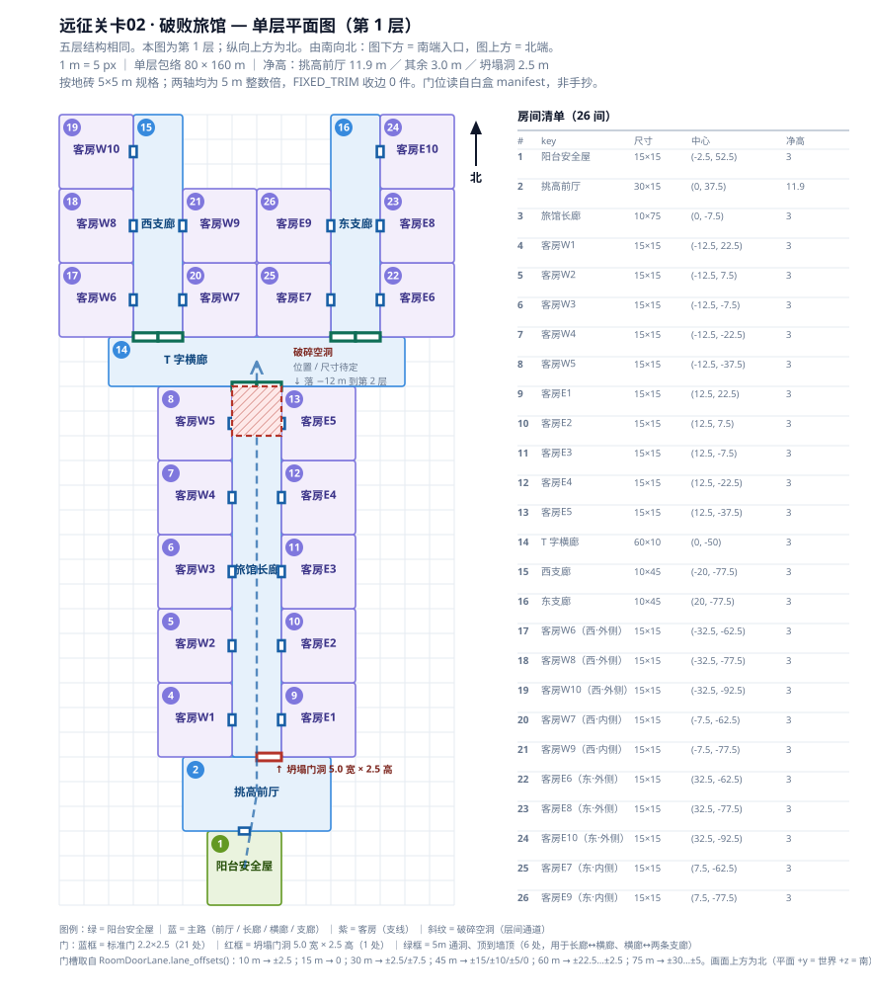
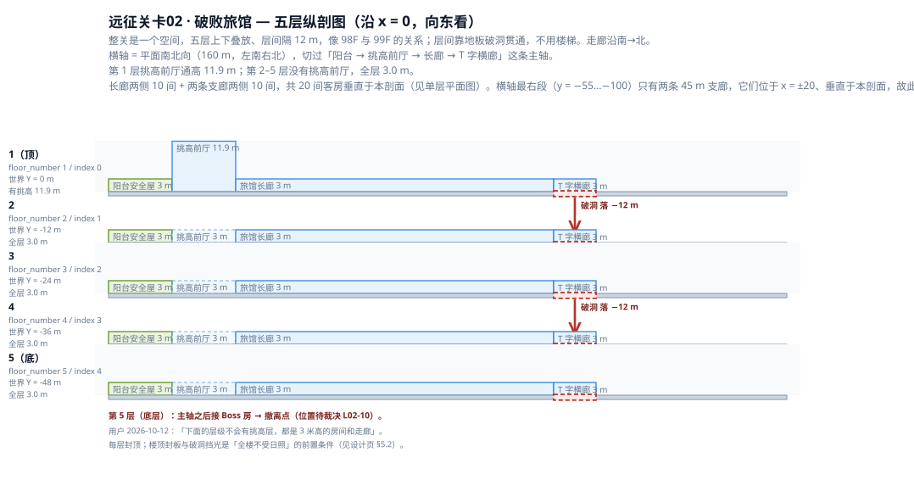

# 远征关卡02 设计

> **命运投放目标（2026-10-18确认）**：本关只开放33个卡种，全部正位，回玩同样受限；名单、教学节奏及实现边界唯一见[六关投放设计](命运卡六关投放设计.md)。当前随机池代码尚未接入这一限制。

工程版本 0.1.0。本页是**远征关卡02 作为一张独立关卡的目标设计**：它应该长什么样、玩家在里面怎么走、边界在哪里。
当前实现事实与接口见[关卡生成与爬楼](../05_技术施工_关卡生成与爬楼.md)；版图 schema 与门槽公式见[关卡版图白盒与生成规范](../05.2_关卡版图白盒与生成规范.md)；区块归属见[关卡区块设计 §3.0](../05.1_关卡区块设计.md)。

> **文档归属 —— 本页是设计文档，不是账本文档。**
>
> - **归类**：`docs/v0.1/design/`（v0.1 目标规则主设计区，按关卡编号归类；与按功能归类的设计页并列，见[设计区索引](README.md)）。
> - **主设计归属**：FeatureID **`WORLD-PLAN`**（关卡结构）与关联 **`ASSET-PIPELINE`**（组件/房间生产）。`FloorPlanGenerator` 负责关卡计划；Blender 源拥有组件几何材质；正式 Godot 房间 TSCN 拥有房内布局、灯光、启用和实例参数。
> - **资产事实的唯一权威是账本，不是本页。** 本关尚无任何房型资产登记，§8 只写「需要什么、缺口在哪」。
> - **对外可接通的文档**分四类，逐条列在 **§11**。

> **这一关和远征关卡01 的区别：** 01 是**单层开放平房群** —— 一张版图、一条主路、走完就回家。02 是**五层垂直下行的密闭旅馆** —— 每层结构相同（一条长廊 + 两侧客房），层与层之间**从破碎的空洞掉下去**，一路往下。

> ⚠️ **本页状态（2026-10-13 相机/墙高/去门施工版）：** 设计意图 + 单层平面几何已定；远征02专属固定方向第三人称相机已扩展到 T 字分叉、两条支廊及支廊客房，并保持平滑过渡、固定世界方向和墙体/顶盖碰撞约束。普通旅馆墙体运行时补齐到顶盖底面 4.0 m，挑高前厅仍保持 11.9 m 通高。普通连接门暂时不生成实体门扇和门扇碰撞，但保留 authored 端口、开放门洞与路线；阳台东侧 EXIT 楼梯和唯一 `expedition_retreat` 退出交互保留。正式独立 H4 墙组件仍需按 02b 资产链路补齐。五层下行仍未接通，见下面第 5 条。

> 🛑 **本关仍有三项要求超出了"按现有规则办"，不得当成已完成路径：**
>
> | # | 要求 | 现状（已核实） |
> |---|---|---|
> | 1 | 普通房间墙顶与普通房顶盖底对齐 **4.0 m** | **本轮已接入运行时补齐**：现有 H3 普通墙/门墙上方增加 1.0 m 的独立视觉与 layer=1 碰撞补段；普通封顶房顶盖底 4.0 m；`room_01` 的挑高前厅继续使用 H12。正式 `wall_standard_5m_h4` 组件与 02b 证据仍待资产链路补齐。见 §5.1、§8.1.4 |
> | 2 | 进房后**自动切换固定方向第三人称镜头** | **已落地**：远征02使用房间级 `camera_profile`；相机从 `room_01` 高位平滑下降到角色头部附近，并可在多个地点平滑改变固定世界方向；不读取玩家 yaw，且保留墙体、顶盖和楼板碰撞。见 §5.4、§8.1.5 |
> | 3 | **可破坏的墙壁与场景组件** | `src/` 全库**零**可破坏物 / 耐久 / 破坏状态机。最近的 `scene-art-damage-variant-kit` 只是**静态外观变种**，打不掉。见 §6 |
> | 4 | **旅馆专属房型** | **已落地为远征02 authored 专属静态布局**：26 间房、1097 个组件实例，按白盒逐件组装；房型模板与账本登记仍需按现有资产治理补齐，历史模板锁定/新增模板裁决见 §3.0、§8.1.2 |
> | 5 | **五层垂直下行** | L1 `floors[]` 数组与 `floor_index → 世界 Y = −12 × index` 的堆叠公式**现成**；但**远征链路当前仍是单层**，且**没有"从地板洞口掉到下一层"机制**。见 §5.5 |
>
> §13 保留尚未实现的系统裁决项（可破坏件、五层下行、内容收益等）；已落地的高度、相机、静态组装和光照口径以本页正文及 §8.1 验收记录为准。

---

## 1. 关卡身份

| 项目 | 值 |
|---|---|
| 关卡标识 `level_id` | `expedition_02` |
| 界面显示名 | 远征关卡02 |
| 设定名 | 破败旅馆 |
| 所属区块 `block_id` | `expedition` |
| 关卡形态 | **单层独立行动 · 五层垂直下行**（层间不靠楼梯，靠破碎空洞坠落） |
| 层数 | **5 层**（第 1 层为顶层，第 5 层为底层） |
| 场景树归属 | 独立场景，区块根只有一个 `Blocks/Expedition` |
| 场景文件 | `scenes/ExpeditionLevel02_3D.tscn`（**已建立并接入**） |
| 派生的关卡 id `run_id` | `expedition_02` |
| 设计源目录 | `data/level_plans/expedition_02/`（**已建立；当前正式运行源为 `level_plan.json` + `floors/floor_00.json`**） |
| 关卡登记点 | `src/framework/GameDesignConfig.gd` 的 `EXPEDITION_LEVELS`（**已追加，且不是首条**） |
| 专属门禁 | `tests/verification/verify_expedition_level02_flow.gd`（**尚未补齐；当前由专项场景/探针覆盖高度、光照、组装和相机**） |
| 副标题（读取界面用） | 五层下行 · 阳台安全屋 → 挑高前厅 → 长廊与客房 ×5 层 → 底层撤离点（**草案**） |
| 目标文案（HUD 用） | 一层层往下，穿过长廊与两侧客房，抵达底层撤离点。（**草案**） |

> **登记点是追加、不是首条。** `EXPEDITION_LEVELS` 的**清单首条 = 未指定关卡时的默认终点**，远征关卡01 已占该位。02 一律**追加在后面**，否则会静默改掉整条传送链的落点。

**进入路径：** 99F 基地中央远征情报室（`mission_operations`）→ 选关菜单 → 读取界面 → 本关卡；另可从塔3天台机房门前交互确认后进入同一读取界面。
**离开路径：** 底层撤离点撤离 / 死亡 / 第 1 层阳台的弃局门，均按既有规则结算。

本关卡**不继承塔楼主场景**，父场景是公共关卡基座 `scenes/Dungeon3D.tscn`，覆写脚本 `TowerDescent3D.gd` 并设 `expedition_mode = true`。区块树里没有 `Blocks/Rooftop` / `Blocks/Base` / `Blocks/Battle` / `Blocks/Stairs`。

---

## 2. 玩法循环

**五层垂直下行。** 每层的**结构相同**，一路向南→北（偶数层镜像为北→南），层与层之间**从破碎空洞坠落**。

```text
基地中央远征情报室（选关） / 塔3机房门（确认）
  → 读取界面（过场）
  → 【第 1 层 · 顶层】阳台安全屋（唯一弃局门）
                      → 挑高前厅    净高 11.9 m
                      → 坍塌门洞    只有 2.5 m 高
                      → 旅馆长廊    顶盖底 4.0 m、走面到顶盖底净高 3.70 m，两侧开出客房
                      → 破碎空洞    坠落
  → 坠落 −12 m ↓
  → 【第 2 层】同一套结构，**南北镜像**：阳台落在上一层空洞的正下方
  → 坠落 −12 m ↓
  → 【第 3 层】同第 1 层
  → 坠落 −12 m ↓
  → 【第 4 层】同第 2 层
  → 坠落 −12 m ↓
  → 【第 5 层 · 底层】… → Boss 房 → 撤离点
  → 撤离成功 → 结算 → 返回本次出发入口
```

**单层模块（5 间房 + 1 个洞口）—— 这是本关的最小重复单元：**

| 位置 | 房 | 尺寸 | 作用 | 净高 |
|---|---|---|---|---|
| 起 | **阳台安全屋** | 15 × 15 | 本层的到达点（第 1 层是真正的出生点，第 2–5 层是上一层空洞的落点）；第 1 层这里有唯一弃局门 | 露天，不封顶 |
| ① | **挑高前厅** | 10 × 30 | 全楼唯一的通高空间 —— 与低矮长廊形成**强对比**。**只第 1 层有** | **11.9 m，露天不封顶** |
| ② | **坍塌门洞** | 洞口 5.0 宽 × 2.5 高 | 挑高前厅正面的坍塌开口，**只有 2.5 m 高**（标准门楣底仍是 2.80 m）；穿过它才算进入长廊段 | 2.5 m 门洞 |
| ③ | **旅馆长廊** | **10 × 75** | 本层的骨架，主轴**贯通南→北** | **顶盖底 4.0 m；走面到顶盖底净高 3.70 m** |
| ④ | **两侧客房** | 15 × 15 × **10 间** | 长廊**东西**两侧各 **5 间**可进入房间（`role = "branch"`） | **顶盖底 4.0 m；净高 3.70 m** |
| 终 | **破碎空洞** | 待定 | 楼层地板塌陷的洞口，**唯一的层间通道** —— 掉下去到下一层的阳台 | — |
**空间性格（三条骨架）：**

| 骨架 | 含义 | 落地影响 |
|---|---|---|
| **密闭** | 除第 1 层阳台安全屋与挑高前厅外，其余房间封顶；顶盖底 4.0 m、走面到顶盖底净高 3.70 m | 封顶房不受太阳直射（§5.2）；镜头在低矮区域切换到头部高度（§5.4）；怪恒为 `darkness` / `artificial_light` |
| **高差对比** | 「挑高 11.9 m 的房间」→「2.5 m 的坍塌洞口」→「顶盖底 4.0 m、走面净高 3.70 m 的长廊」 | 玩家每层都会先经历一次**从开阔到压迫**的收窄；洞口的 2.5 m 是**视觉与体感的锚点** |
| **重复 + 镜像** | 五层结构相同，偶数层南北镜像 | 玩家学会一层就懂五层；镜像让**竖井上下对齐**（§4.3），建筑轮廓不随层漂移 |

**三个出口的语义：**

| 出口 | 触发位置 | 结果 |
|---|---|---|
| 撤离成功 | 第 5 层撤离点的撤离信标 | 正常结算，带走本局收益 |
| 死亡 | 任意内容房 / Boss 房 / **坠落途中** | 按死亡规则结算 |
| 主动弃局 | 第 1 层阳台的出口门 | 未开始就退出，不推进进度 |

> ⚠️ **玩家掉落会不会被判死亡：不会。** 玩家有重力与 `falling` 状态（`Player3D.gd:47-50`），但**没有坠落伤害**；且安全兜底 `FALL_RECOVERY_DISTANCE_M := 15.0`（`Player3D.gd:55`）**大于一层层高 12 m**，所以"掉一层"不会被抓回原点。**若层高或落差调到 ≥15 m，玩家会被传送回原地 —— 这是必须知道的边界。**（怪的阈值是 `Enemy3D.FALL_DEATH_DROP_M := 15.0`，掉下去直接判死。）

**本关的节奏变量是「每层待多久」。** 长廊直走最快；进两侧客房拿构筑次数但要暴露在顶盖底 4.0 m、走面净高 3.70 m 的封顶空间里打完。**每层的客房收益/代价必须先定死（§13 L02-6）**，否则客房会退化成"必进"，五层就只是把一层重复五遍。

---

## 3. 房型库

### 3.0 模板、白盒和 authored 静态装配口径

**当前落地口径：** 远征02不使用随机房间排列种子，也不把远征01的程序化房间几何带入本关。运行时读取 `data/level_plans/expedition_02/` 的 authored 计划和 `assets/art/environments/tower_zones/expedition/runtime/room_instances/expedition_02/` 的正式房间静态布局；房间位置、门位、墙体、顶盖和通洞均以白盒 manifest 与 L2 端口数据为准。

远征02当前使用旅馆专属模板 id：`hotel_safe_15x15`、`hotel_foyer_30x15`、`hotel_corridor_10x75`、`hotel_guest_15x15`、`hotel_tee_60x10`、`hotel_branch_10x45`。这些模板已落在 `data/level_plans/expedition_02/room_templates/`，不再是「没有对应模板」的待裁决状态；后续仍需按资产治理补齐账本行与长期房型生产链记录。

| 口径 | 当前状态 | 说明 |
|---|---|---|
| 固定 authored 平面 | **已落地** | `mode = "authored"`、`runtime_enabled = true`；不使用随机房间排列种子 |
| 白盒逐件组装 | **已落地** | 26 间房、1097 个组件实例；正式房间场景按白盒 manifest 逐件对账 |
| 旅馆专属模板 | **已落地到设计源与运行时引用** | 六个 `hotel_*` 模板已存在；账本补录与专属门禁仍是后续治理项 |
| 远征01隔离 | **已落地** | 静态布局路径按 `level_id` 派生；缺失时告警，不静默回退到 `expedition_01` |

> **主题落地原则：** 模板几何、门槽和组件边界由白盒与 authored 设计源拥有；旅馆化陈设、灯光和房内表现由正式房间 TSCN 拥有。不得用运行时随机重排或远征01程序化拼装覆盖本关 authored 布局。

### 3.1 房型映射（当前 authored 模板与运行时房间）

| 用量 | 尺寸 宽×深 (m) | 旅馆化中文名 | 在旅馆里的作用 | 锁定集合里的对应 |
|---|---|---|---|---|
| 1 | 15 × 15 | **阳台安全屋** | 南端入口；第 1 层有唯一弃局门 | `safe_15x15`（尺寸对得上） |
| 1 | **30 × 15** | **挑高前厅** | 全楼唯一的 11.9 m 通高房间，**横置**；只第 1 层有 | `hotel_*` 专属模板 |
| 1 | **10 × 75** | **旅馆长廊** | 本层骨架；两条长边各开 5 扇客房的门 | `hotel_*` 专属模板 |
| 20 | 15 × 15 | **客房** | 长廊两侧各 5 间 + 两条支廊**两侧各 3 间** | ⚠️ 只有 `safe_15x15` 尺寸对得上，但语义是安全房 |
| 1 | **60 × 10** | **T 字横廊** | 长廊北端的拐弯横廊 | `hotel_*` 专属模板 |
| 2 | **10 × 45** | **支廊** | 横廊两端向北折出的长支廊，**两侧各挂 3 间客房** | `hotel_*` 专属模板 |
| 1 | 50 × 40 | 顶层套房 | 终局战斗 | `boss_50x40` |
| 1 | 25 × 25 | 后门 / 消防梯口 | 撤离点，常驻撤离信标 | `extraction_25x25` |

> **当前实现说明：** 历史锁定模板集合与本版 authored 几何不同；当前实现已使用远征02专属 `hotel_*` 模板，并写入 `data/level_plans/expedition_02/room_templates/` 和 L2 房间计划。白盒、静态房间场景与 authored 运行时布局的逐件对账已通过。账本补录和专属门禁仍需后续闭环。

### 3.2 单层模块的构成（**已定，见 §4.2 坐标**）

**每层 26 间房：**

```text
（南端 y = +60）
阳台安全屋(15×15) → 挑高前厅(30×15 横置，净高 11.9m) → [坍塌门洞 5.0 宽 × 2.5 高]
  → 旅馆长廊(10×75，独立房间、贯通，沿南→北)
        ├─ 西侧客房 W1…W5 (15×15 each，[branch])
        └─ 东侧客房 E1…E5 (15×15 each，[branch])
  → 【T 字路口】长廊北端接 60m 横廊
        ├─ 西端折向北 45m → 西支廊(10×45)
        │        ├─ 外侧客房 W6 / W8 / W10 (15×15，[branch])
        │        └─ 内侧客房 W7 / W9      (15×15，[branch])
        └─ 东端折向北 45m → 东支廊(10×45)
                 ├─ 外侧客房 E6 / E8 / E10 (15×15，[branch])
                 └─ 内侧客房 E7 / E9      (15×15，[branch])
（北端 y = −100）
```

**门数：** 主路房门数 = 2（进 + 出）；挂了客房的廊房每多 1 扇客房门。
**长廊 12 扇**（前厅 1 + 西客房 5 + 东客房 5 + 横廊 1）；**T 字横廊 3 扇**（长廊 1 + 两条支廊各 1）；
**每条支廊 8 扇**（横廊 1 + 两侧客房 5 + 终点 2）。合计 **28 处门洞**（21 樘标准门 + 1 坍塌矮洞 + 6 处 5 m 通洞）。
**支廊接头一律用 5 m 通洞**（占满整格、顶到墙顶、无门楣），所以拐弯处全通透。

> **支廊为什么落在 x = ±20（而不是 ±15）：** `RoomDoorLane.lane_offsets()` 对**偶数段墙不产生 0 槽**。
> 60 m 横廊的合法槽只到 `±22.5`，而 10 m 宽支廊的两个槽在「支廊中心 ±2.5」。
> 要让这两个槽**在横廊侧也合法**，支廊中心必须落在 **±20** ⇒ 槽位 `∓22.5 / ∓17.5`，两侧都命中。
> 顺带：中心 ±20 让两条支廊的内侧房（各 15 m 宽）恰好**在 x = 0 处相接，不重叠**。
>
> **支廊为什么要 45 m：** 45 m 墙的合法槽是 `±15 / ±10 / ±5 / 0`。两侧客房门取各自中线
> （y = 支廊北端起 7.5 / 22.5 / 37.5），与支廊中心 (±20, −77.5) 的偏移正好是 `+15 / 0 / −15`
> —— **三扇门全部落在合法槽上**。若改成 30 m 或 40 m，偶数段墙没有 0 槽，中间那扇门就非法了。

---

## 4. 版图与主路

### 4.1 主路

```text
（每层）阳台安全屋 → 挑高前厅 → [坍塌门洞] → 旅馆长廊 →【T 字路口】→ 两条支廊 → 北端
```

主路内容房 = **挑高前厅 + 旅馆长廊 + T 字横廊 + 两条支廊**；20 间客房是 `branch`。
**T 字路口是全关唯一的「选择点」** —— 两条支廊等长（各 45 m、各挂 6 间客房），
玩家选哪条都能继续向北；第 5 层的终点（Boss 房 / 撤离点）挂在其中一条的末端（§13 L02-10）。

### 4.2 单层房表（第 1 层 · 平面坐标）

> **坐标是设计值，几何真源将来落在 L2。** 单位米；平面 `+y` = 南、`−y` = 北（§4.5）。
> **走廊沿南→北**：玩家从南端（y 大）进，一路向北（y 减小）。
> 本表已与白盒 `ENV-EXPEDITION-L02-HOTEL-FLOOR-01` v001 逐值同步（见 §8）。

| # | key | 中文名 | 角色 | 尺寸 宽×深 (m) | 中心 (x, y) | 父房 | 净高 (m) |
|---|---|---|---|---|---|---|---|
| 1 | `entry` | 阳台安全屋 | `stair_entry` | 15 × 15 | (−2.5, 52.5) | — | 露天，不封顶 |
| 2 | `room_01` | 挑高前厅 | `main` | **30 × 15** | (0, 37.5) | `entry` | **11.9，露天不封顶** |
| 3 | `room_02` | 旅馆长廊 | `main` | **10 × 75** | (0, −7.5) | `room_01` | **顶盖底 4.0；净高 3.70** |
| 4 | `room_03` | 客房W1 | `branch` | 15 × 15 | (−12.5, 22.5) | `room_02` | 顶盖底 4.0；净高 3.70 |
| 5 | `room_04` | 客房W2 | `branch` | 15 × 15 | (−12.5, 7.5) | `room_02` | 顶盖底 4.0；净高 3.70 |
| 6 | `room_05` | 客房W3 | `branch` | 15 × 15 | (−12.5, −7.5) | `room_02` | 顶盖底 4.0；净高 3.70 |
| 7 | `room_06` | 客房W4 | `branch` | 15 × 15 | (−12.5, −22.5) | `room_02` | 顶盖底 4.0；净高 3.70 |
| 8 | `room_07` | 客房W5 | `branch` | 15 × 15 | (−12.5, −37.5) | `room_02` | 顶盖底 4.0；净高 3.70 |
| 9 | `room_08` | 客房E1 | `branch` | 15 × 15 | (12.5, 22.5) | `room_02` | 顶盖底 4.0；净高 3.70 |
| 10 | `room_09` | 客房E2 | `branch` | 15 × 15 | (12.5, 7.5) | `room_02` | 顶盖底 4.0；净高 3.70 |
| 11 | `room_10` | 客房E3 | `branch` | 15 × 15 | (12.5, −7.5) | `room_02` | 顶盖底 4.0；净高 3.70 |
| 12 | `room_11` | 客房E4 | `branch` | 15 × 15 | (12.5, −22.5) | `room_02` | 顶盖底 4.0；净高 3.70 |
| 13 | `room_12` | 客房E5 | `branch` | 15 × 15 | (12.5, −37.5) | `room_02` | 顶盖底 4.0；净高 3.70 |
| 14 | `room_13` | T 字横廊 | `main` | **60 × 10** | (0, −50) | `room_02` | 顶盖底 4.0；净高 3.70 |
| 15 | `room_14` | 西支廊 | `main` | **10 × 45** | (−20, −77.5) | `room_13` | 顶盖底 4.0；净高 3.70 |
| 16 | `room_15` | 东支廊 | `main` | **10 × 45** | (20, −77.5) | `room_13` | 顶盖底 4.0；净高 3.70 |
| 17 | `room_16` | 客房W6（西·外侧） | `branch` | 15 × 15 | (−32.5, −62.5) | `room_14` | 顶盖底 4.0；净高 3.70 |
| 18 | `room_17` | 客房W8（西·外侧） | `branch` | 15 × 15 | (−32.5, −77.5) | `room_14` | 顶盖底 4.0；净高 3.70 |
| 19 | `room_18` | 客房W10（西·外侧） | `branch` | 15 × 15 | (−32.5, −92.5) | `room_14` | 顶盖底 4.0；净高 3.70 |
| 20 | `room_19` | 客房W7（西·内侧） | `branch` | 15 × 15 | (−7.5, −62.5) | `room_14` | 顶盖底 4.0；净高 3.70 |
| 21 | `room_20` | 客房W9（西·内侧） | `branch` | 15 × 15 | (−7.5, −77.5) | `room_14` | 顶盖底 4.0；净高 3.70 |
| 22 | `room_21` | 客房E6（东·外侧） | `branch` | 15 × 15 | (32.5, −62.5) | `room_15` | 顶盖底 4.0；净高 3.70 |
| 23 | `room_22` | 客房E8（东·外侧） | `branch` | 15 × 15 | (32.5, −77.5) | `room_15` | 顶盖底 4.0；净高 3.70 |
| 24 | `room_23` | 客房E10（东·外侧） | `branch` | 15 × 15 | (32.5, −92.5) | `room_15` | 顶盖底 4.0；净高 3.70 |
| 25 | `room_24` | 客房E7（东·内侧） | `branch` | 15 × 15 | (7.5, −62.5) | `room_15` | 顶盖底 4.0；净高 3.70 |
| 26 | `room_25` | 客房E9（东·内侧） | `branch` | 15 × 15 | (7.5, −77.5) | `room_15` | 顶盖底 4.0；净高 3.70 |

**走向（由南向北）：** 阳台在最南 **y = +60 一侧** → 挑高前厅 `y = +30…+45` → 坍塌洞在 `y = +30` 线上 →
长廊从 `y = +30` 到 **y = −45** → T 字横廊 `y = −55…−45` → 两条支廊（x = ±20）向北到 **y = −100**。

**封顶统一口径（2026-10-13）：** 普通封顶房的 `ceiling_deck_5m` 底面标高为 **4.0 m**；走面标高为 0.30 m，因此玩家可用净高为 **3.70 m**。墙顶标高为 3.0 m，墙顶至顶盖底面保留 1.0 m 管线空腔。`start`（设计 key `entry`）与 `room_01` 保持露天，不生成顶盖。
玩家沿 **−y 方向**推进。**平面 +y = 南 ⇒ 南端 y 大、北端 y 小。**

**单层包络 80 × 160 m**（x ∈ [−40, 40]，y ∈ [−100, 60]），几何中心 (0, −20)。**26 间房两两相接（共墙），外墙围成一圈。**

**占位校验（白盒实测，全部通过）：**

| 项 | 值 |
|---|---|
| 模数 | 26 间房的 x0/y0/x1/y1 **全部是 5 的整数倍** |
| 重叠 / 空洞 | **无重叠**；连通性：**26 间全连通**（同一连通分量） |
| 面积 | 阳台 225 ／ 挑高前厅 450 ／ 长廊 750 ／ 客房 225 ×20 ／ 横廊 600 ／ 支廊 450 ×2 ⇒ 单层 **7425 m²** |
| `FIXED_TRIM` 收边 | **0 件**（两轴均为 5m 整数倍） |
| 墙模块 | **239** 个；单件最长 **5.0 m** |
| 网格对象 | 26 地板整板 + **297** 地砖 + **211** 实墙 + **64** 门墙件 = **598** |
| 门洞 | **28 处**（21 樘标准门 + 1 坍塌矮洞 + 6 处 5 m 通洞） |
| 门槽合法性 | **全部合法、0 违规** |
| **房间内隔墙** | **0 处**（硬门禁：同一间房的两侧之间不许生成墙 —— 长廊因此贯通） |
| 通洞真空 | **0 处被墙堵**（硬断言：`open` 洞那段网格上不许有任何墙件） |

> **门槽取值：**
> 阳台(15 m, 槽 0) ↔ 挑高前厅(30 m, 槽 ±2.5/±7.5) 取 `x = −2.5`；
> 挑高前厅 ↔ 长廊 的**坍塌洞**门心 `x = +2.5`、宽 5.0 m、高 2.5 m；
> 长廊(75 m, 槽 ±5k) ↔ 客房(15 m, 槽 0) 取客房中线；
> **长廊 ↔ 横廊** 在 `y = −45` 线上东西各开一个 5 m 通洞（覆盖长廊整个宽度 ⇒ 通透）；
> **横廊(60 m) ↔ 支廊(10 m)** 在 `y = −55` 线上各开两个 5 m 通洞，门心 `x = ∓22.5 / ∓17.5`
> —— 这两个值**同时是 60 m 横廊的合法槽**，所以通洞两侧都成立；
> **支廊(45 m) ↔ 两侧客房(15 m)** 门心取客房中线，相对支廊中心偏移 `+15 / 0 / −15`，三个都是 45 m 墙的合法槽。

### 4.3 五层怎么叠

**整关是「一个空间」，像 98F 与 99F 的关系 —— 五层上下叠放、层间隔 12 m，靠地板破洞上下贯通。**

| 层 | `floor_number` | `floor_index` | 世界 Y | 模块 | 挑高前厅 |
|---|---|---|---|---|---|
| 1（顶） | 1 | 0 | 0 | 单层 13 房模块（§4.2） | **有**（11.9 m） |
| 2 | 2 | 1 | −12 | 同上，**去掉挑高前厅** | 无 |
| 3 | 3 | 2 | −24 | 同上 | 无 |
| 4 | 4 | 3 | −36 | 同上 | 无 |
| 5（底） | 5 | 4 | −48 | 同上；长廊之后接 Boss 房 → 撤离点 | 无 |

```text
世界 Y = −12.0 × floor_index          （TowerDescent3D._plan_world_position，层高全局常量 12.0）
```

**层间通道 = 地板破洞，不是楼梯。** 每层长廊地板上开一个洞，掉到下一层同一个洞口位置。
洞的尺寸与位置**待定**（§13 L02-9 / L02-7）。

**五层同为一个平面坐标系**（不做逐层镜像）—— 因为整关是一个垂直空间，
上下层必须**轮廓完全对齐**，否则"掉下去"接不到下一层。

> ⚠️ **第 2–5 层没有挑高前厅。** 用户 2026-10-12 明确：「下面的层级不会有挑高层，都是普通封顶房」。当前普通房统一采用：墙顶 3.0 m、顶盖底面 4.0 m、走面到顶盖底净高 3.70 m。⇒ 挑高 11.9 m 是**第 1 层的独有特征**，也是玩家进入这栋楼时的第一印象。


### 4.4 图纸



*单层平面图（**第 1 层**）。**由南向北**：图下方为南端入口 —— **阳台安全屋(15×15) → 挑高前厅(30×15 横置，净高 11.9 m) → 坍塌门洞(宽 5.0 × 高 2.5 m) → 旅馆长廊(10×75，顶盖底 4.0 m、走面净高 3.70 m，贯通，沿南→北) → 东西两侧各 5 间客房(15×15) → 【T 字路口：60 m 横廊，两端各向北折 45 m 支廊，每条支廊两侧各 3 间客房】→ 北端**。画面上方为北（平面 +y = 世界 +z = 南）。第 2–5 层沿用本模块但无挑高前厅，普通房顶盖底 4.0 m、走面净高 3.70 m。破碎空洞位置待定（图中暂标在 T 字横廊内）。*



*五层纵剖图（沿 x = 0 轴，向东看；横轴左 = 南、右 = 北）。每层物理层高 **12 m**；第 1 层挑高前厅通高 **11.9 m**，其余普通房间与所有下层采用墙顶 **3.0 m**、顶盖底 **4.0 m**、走面净高 **3.70 m**；坍塌门洞 **2.5 m**。**整关是一个空间**：五层上下叠放，层间靠地板破洞贯通（洞位置待定），不用楼梯。*

> 📐 **[→ 打开远征关卡02 平面图集](refs/expedition02/远征关卡02平面图集.html)**（单层平面图 + 五层纵剖图 + 房间明细表 + 五层叠放表）。单张图在 [`refs/expedition02/plans/`](refs/expedition02/plans/)。图由本页 §4.2 / §4.3 两张表**加白盒 manifest 的门位**驱动（改表 → 重跑 `scripts/render_expedition02_plan_sheet.py`）。**几何真源将来是设计源 `floors/floor_NN.json`；本页表格与图纸都还不是设计源。**

### 4.5 走向与方位约定（跨语言红线，写错不报错）

```text
平面 +y  →  世界 +z  →  south（南）
平面 −y  →  世界 −z  →  north（北）
```

来源：`TowerDescent3D._plan_world_position`（`Vector3(x, -层高, y)`）+ `Dungeon3D._direction_between`（`delta.z >= 0 → "south"`）。

**「第 1 层由南向北」的落法：** 阳台在**平面 y 较大**的一侧，破碎空洞在**平面 y 较小**的一侧，主路沿 `−y` 推进。偶数层镜像后方向反转。

> 🛑 **门侧写反不会让任何几何校验失败**（`lane_m` 仍然对），只会让门连错方向。历史上有过整体反向而无人发现的事故，现在靠 `port_derivation_mismatch` 断言盯住。**不要目测，跑 §10 第 3 步取数。**

### 4.6 「两侧客房」的落法

| 落法 | 含义 | 取用 |
|---|---|---|
| **① 支线房（`role = "branch"`）** | 从长廊 / 支廊两侧延展出去的可进入房间；被挂的廊房每多 1 扇门 | **本页采用**。机制现成（`branch_count_range` 保留、顶级支线计数规则在） |
| **② 破墙开洞** | 长廊侧墙做成可破坏件，打穿后进客房 | 依赖**尚未存在的**可破坏系统（§6），且会让"房间"不再是可校验单元 |

**20 间客房分两处挂：** 长廊东西两侧各 5 间（`room_03…room_12`）、
**两条支廊两侧各 5 间**（`room_16…room_25`：「外侧」3 间 +「内侧」2 间）。
支廊侧的门是**双向可进**的 —— 支廊两侧都挂房，所以支廊本身也是 `main`（主路的一部分），
拐弯后仍有房间可探索，不是空走廊。

### 4.7 门与连接

- 门契约全场统一：净空 **2.2 × 2.5 m**，门槛底 `0.3 m`，门楣底 `2.8 m`（`TowerGeometry3D.gd:6/7`）。
- 使用 L2 `connection_ports` 作为真实门洞真源；每个端口写稳定 `A/B/C...` 编号、房间局部坐标与局部朝外方向。
- 连接按端口编号成对声明；**两端锚点世界坐标必须重合、朝外方向必须相反**；端口与房型内容（含刷怪盒）随整房旋转。
- 一条边只生成一套门墙、门扇、碰撞和 `RoomDoor3D`；非所有者端只登记同一门对象；空 `target` 的候选端口必须由本房普通实墙封住。
- **入口房运行时 id 必须字面量 `start`**（靠 `legacy_room_id = "start"` 映射）；**撤离房 key 必须字面量 `extraction`**。写错**完全静默**。

**单层门数（第 1 层）：**

| 房间 | 门数 | 连到谁 |
|---|---|---|
| 阳台安全屋 `entry` | 2 | 挑高前厅（前门）+ 弃局门（无目标，仅第 1 层） |
| 挑高前厅 `room_01` | 2 | 阳台（进）+ 长廊（出，**坍塌门洞 2.5 m**） |
| 旅馆长廊 `room_02` | **12** | 前厅 1 + 西客房 5 + 东客房 5 + T 字横廊 1 |
| 客房 W1…W5 / E1…E5 | 各 1 | 长廊 |
| T 字横廊 `room_13` | **3** | 长廊 1 + 西支廊 1 + 东支廊 1（**三处全是 5 m 通洞**） |
| 西支廊 `room_14` / 东支廊 `room_15` | 各 **6** | 横廊 1 + 外侧客房 3 + 内侧客房 2 |
| 支廊两侧客房（10 间） | 各 1 | 各自的支廊 |
| 破碎空洞 | — | **不是房间**，是地板里的开洞（§5.5）；位置待定 |

合计 **28 处门洞** = 21 樘标准门 + 1 坍塌矮洞 + 6 处 5 m 通洞。

> ⚠️ **「长廊的出」与「到下一层」是同一件事** —— 空洞在地板里，走到北端支廊尽头就是踩进洞口。
> **这一条与现有"房间出口必须是另一间房"的模型不一致，是 §13 L02-9 要裁决的点。**

**跨层（竖向）边：** 层间不生成楼梯井，而是**竖直落体通道**。这条边在现有实现里由 `_append_next_arrival_shell()` 隐式生成（塔楼里做成楼梯井），本关需要**改成"空洞"语义**（§5.5）。

### 4.8 内容分配（**待裁决**）

| 项 | 建议 |
|---|---|
| 主路内容房 | 每层 2 间（挑高前厅 + 旅馆长廊），**全关 10 间** |
| 支线房 | 每层 2 间（客房），**全关 10 间** |
| 内容类型池 | 沿用 01 的配方（`COMBAT×5 / SCAVENGE×3 / STORAGE×1 / EVENT×1`），按 10 间主路内容房一一对应 |
| 类型分配 | 按房号钉死（不按种子洗牌），与 01 一致 |
| 刷怪承载 | 触发盒（`spawn_boxes_only: true`）。普通封顶房走面净高为 **3.70 m**；现行 10 m 宽走廊因刷怪盒边缘规则不放置刷怪盒，客房与前厅的盒体仍需按实际房间尺寸复核 |
| 掉落表 | 关卡级 `monster_drop_table`（编辑面是 CSV，导出到 L1） |

### 4.9 随机性边界

沿用 01 口径：**房型/变体按房号固定**、**整房摆位**在端口约束内搜索、**房内布局**由正式 TSCN 拥有、**玩法内容**按房号固定。

---

## 5. 空间口径：层高、封顶、窗、镜头、下行

### 5.1 层高：墙顶、顶盖底和可用净高分开记录

**实现口径（2026-10-13）：** 远征02普通封顶房已经完成 4.0 m 顶盖调整；不要再把「3.0 m 墙顶」误写成「3.0 m 玩家净高」。本关三项高度分别如下：

| 部位 | 当前值 | 说明 |
|---|---:|---|
| **挑高前厅** | **11.9 m** | `WALL_VISUAL_HEIGHT_M`，第 1 层独有，露天不封顶 |
| **普通房墙顶** | **3.0 m** | 3 m 版实墙 / 门墙的几何顶高 |
| **普通房顶盖底面** | **4.0 m** | `ceiling_deck_5m` 底面；墙顶上方保留 1.0 m 管线空腔 |
| **走面到顶盖底净高** | **3.70 m** | 走面标高 0.30 m，因此 `4.00 − 0.30 = 3.70 m`；这是玩家可用净高 |
| **坍塌门洞** | **2.5 m** | 洞口视觉高度；标准门楣底仍为 2.80 m |
| 物理层高（层与层之间） | **12.0 m** | `FLOOR_HEIGHT_M`，全局层间落差；五层下行尚未接通 |

**普通房的最终空间链：** 墙顶 3.0 m → 1.0 m 管线空腔 → 顶盖底 4.0 m；顶盖厚度 0.26 m，上表面 4.26 m。`start`（设计 key `entry`）与 `room_01` 不生成顶盖，保持露天。

**相机与净高：** 顶盖是带 layer 1 碰撞的实心遮挡体。竖直探测命中 4.0 m 顶盖底面后，相机允许高度为 `clamp(4.0 − 0.30 − 0.28, 1.25, 10.262659) = 3.42 m`；远征02的房间级 `camera_profile` 还会把普通区域平滑过渡到角色头部附近的固定方向第三人称机位，详见 §5.4 和 §8.1.5。

**门和刷怪余量：** 门槛底 0.30 m、门净高 2.50 m、门楣底 2.80 m；3.0 m 墙顶上方保留 0.20 m 过梁。玩家可用净高为 3.70 m，超过现有 `SPAWN_BODY_HEIGHT_M = 2.6 m` 的刷怪体高度假设 1.10 m；但走廊刷怪盒仍受 10 m 宽度规则限制，当前按不在走廊放置刷怪盒处理，见 §13 L02-12。

### 5.2 封顶、纯黑远景与「不受太阳照射」——映射到既有硬契约

**远征02远景口径（2026-10-13，已落地）：** 远处必须是纯黑，不沿用全塔默认的灰蓝背景、环境光或距离雾。远征02专属环境模式已将背景色、环境光和雾光压为黑色并关闭屋顶补光 `RooftopSkyBounce`；方向光仍保留，用于 `room_01` 挑高前厅和近景真实照明。因此「远景纯黑」与「近景可见」是有意分离的两条规则：远处不漏光，入口前厅不因全局关灯而变成不可见黑屏。

| 项 | 远征02口径 | 验收事实 |
|---|---|---|
| 背景 | `Environment.BG_COLOR` + `Color.BLACK` | 纯黑背景 |
| 环境光 | `ambient_light_color = Color.BLACK`、`ambient_light_energy = 0.0` | 不给远景抬亮度 |
| 雾光 | `fog_light_color = Color.BLACK`、`fog_light_energy = 0.0` | 不产生灰蓝远雾 |
| 屋顶补光 | `RooftopSkyBounce.visible = false`、能量为 `0.0` | 不从远处补亮 |
| 方向光 | 保留 | 只负责近景 / 前厅照明，不作为远景环境光 |

实测 `room_02` 远景平均亮度已降至约 `0.025202`；`EXP02_LIGHT_DIAG_OK` 与远征01回归验收均通过。后续若调整环境参数，必须同时复查「room_02 远景纯黑」与「room_01 近景仍可见」，不能用关闭方向光的方式一刀切。

**判定机制（不是"画面上有阴影"）：** `src/enemy3d/EnemyIllumination3D.gd` 的 `_evaluate_sunlight()`（L160）从怪物**身体采样点**（脚 / 躯干 / 头三点，L298）沿**主太阳方向的反方向**打一条 `occlusion_mask = 1`（关卡静态世界层，L20）的物理射线，命中即判"在投影里"。判据（L183-184）：3 点采样 ⇒ **要求 2 点暴露，且中心点必须暴露**。

**⇒ 只要房间上方有带 layer 1 碰撞体的顶盖，射线必被挡，全室不受日照。**

**但"视觉有顶 ≠ 玩法判为投影" —— 这是已经踩过的坑。** 远征01 的 `room_02/06/10` 与 Boss 房天花板视觉齐全、遮出了阴影，实测仍有 **81%~100%** 的采样点直达太阳；根因是顶盖件是 `visual_only`。修复后 0%。记录见[远征01 天花板遮光](../development/2026-10-12_expedition01_ceiling_sun_occlusion.md)。

**本关把"封顶"接在既有硬契约上，`06_技术施工_怪物精英与Boss.md` §7.3.1 要求三项全真（缺一即视为未封顶）：**

1. **有顶盖件** —— 房型布局实例清单里存在覆盖整片屋顶的构件；
2. **该 prefab 带 `layer = 1` 碰撞盒** —— `collision_policy = "structural_box_proxy"`、盒尺寸 = 组件全包络、位置 `y = +高/2`；
3. **静态场景里真落成同名节点**，且 `authored_layout_room_type_component_count` 计入它。

配套两条不能改：顶盖件 `slot_role` 必须是 `room_type_component`（不得是 `solid_wall`）；顶盖用**全包络盒**、不照几何切段。

**本关的封顶要求分为已验收项与五层下行预留项：**

| 层级 | 要求 | 当前状态 |
|---|---|---|
| ① | **24 间普通房封顶** | **已落地并验收**：270 个 `ceiling_deck_5m` 实例，底面 4.0 m；`start` 与 `room_01` 两间露天，不生成顶盖 |
| ② | **顶盖摄像机碰撞** | **已落地并验收**：顶盖 layer 1 + `camera_ceiling_occluder = true`，允许相机高度 3.42 m |
| ③ | **五层竖井不漏光** | **待五层下行接通后实现**：当前只有单层，破碎空洞、楼顶封板和 baffle 尚未进入正式五层运行时结构 |

当前单层普通房的封顶、遮光碰撞和相机碰撞已经闭环；不能把尚未接通的五层竖井遮光要求表述成已完成验收。

**竖井遮光的硬要求（本关独有，必须设计进去）：**

```text
第 1 层的天花板（楼顶封板）是全楼唯一的"天顶"。
它必须：① 有顶盖件；② 带 layer 1 碰撞盒；③ 在静态场景里真落成节点。
任一条不成立 ⇒ 整条竖井从上到下漏光 ⇒ 五层的怪全部被判 sunlight，每秒掉 2% 最大生命。
```

> ⚠️ **竖井不能靠"洞口错位"自然挡光** —— 太阳是方向光（非垂直），倾斜光仍能打进竖直井。**必须在竖井内加折光挡板（baffle）或做成折线井**。本页建议：**楼顶封板 + 每层竖井口加一圈遮光檐（baffle ring）**，并在验收里逐层实测见太阳比例 = 0%（用现成探针）。
>
> **另外：第 N 层"掉落"的那 12 m 落差本身也在竖井里** —— 若竖井漏光，玩家坠落途中会看到天光，观感上也不成立。

**受光三态的后果（`06` §7.7，本关全程适用）：**

| 受光状态 | 移动速度 | 攻击频率 | 生命效果 | 本关预期 |
|---|---:|---:|---|---|
| `darkness` 黑暗中 | 100% | 100% | 无 | **本关基线**（房间灯关掉时） |
| `artificial_light` 受到灯光 | **40%** | **40%** | 无 | 开灯后 |
| `sunlight` 受到太阳光 | 100% | 100% | 每秒损失最大生命 2% | **本关要求为 0%** |

⇒ **灯光不是氛围，是战斗变量：关灯 = 怪不减速。** 普通封顶房以顶盖底 4.0 m、走面净高 3.70 m 为空间基线，封顶本身负责遮挡太阳；房间灯的密度与开关节奏仍是关卡设计的一部分。

### 5.3 窗户：与遮光不冲突，但必须钉死口径

**为什么自由：** 遮光判据是从身体采样点**沿太阳方向朝上**打射线。窗户开在**竖直墙**上，射线朝上要穿过的是**顶盖**，不是墙。**⇒ 只要房间封顶，窗不破坏遮光。**

| # | 口径 | 理由 |
|---|---|---|
| 1 | **窗必须是纯视觉件**（或只带 `camera_only` 层碰撞），**不得在 layer 1 上留豁口** | 墙被挖穿且无 layer 1 遮掩时，低太阳角下射线可能从洞口斜穿 ⇒ 窗边怪被判 `sunlight` |
| 2 | **窗不提供 `artificial_light`** | 受光判定只认显式登记的主太阳灯、注册灯具与玩家手电。**窗边的怪在关灯时仍是 `darkness`（不减速）** |
| 3 | **逐房实测"直接见太阳比例 = 0%"** | 用 `probe_expedition_room_sun_occlusion`，**窗的那一面也必须覆盖** |

### 5.4 室内镜头：**远征02专属 `camera_profile` 已落地**

**实现状态（2026-10-13）：** 远征02已新增房间级 `camera_profile` 数据链路，并在 `TowerDescent3D.gd` 中落地为独立的固定世界方向第三人称镜头。该能力只在 `is_expedition() && get_expedition_level_id() == "expedition_02"` 时启用；远征01、塔楼关卡和全局默认相机继续使用原始相机公式。

**兼容基线（保留）：** 非远征02仍有以下两种通用收镜机制；远征02在其上叠加房间级固定方向 profile，并不删除墙体、楼板和顶盖碰撞约束：

| 机制 | 位置 | 触发 |
|---|---|---|
| 墙后抬升收镜 | `TowerDescent3D.gd:1669` `_update_camera_lower_wall_lift()` | 探针打到带 `camera_lower_wall` 元数据的碰撞体（只有南北向实体墙 / 门墙 / 门 / 内部横隔墙） |
| 楼梯楼板下压 | `TowerDescent3D.gd:1783` `_update_camera_stair_slab_drop()` | 只认带 `camera_stair_slab` 元数据的**楼梯斜楼板** |

**已落地的兼容边界：** 非远征02仍使用现有默认镜头、玩家局部坐标、坐姿下沉、debug trailing/yaw，以及墙体和楼板收镜逻辑；远征02才读取房间级 profile。这样不会改变远征01、塔楼关卡或全局默认相机。

**现有镜头唯一事实源（`TowerDescent3D.gd:156-160`，塔楼与两个远征关卡共用）：**

| 常量 | 值 |
|---|---|
| `CAMERA_HEIGHT_M` | `10.262659` |
| `CAMERA_DEFAULT_TRAILING_M` | `4.914455` |
| `CAMERA_LOOK_HEIGHT_M` | `0.45` |
| `CAMERA_LOOK_AHEAD_M` | `0.75` |
| `CAMERA_FOV_DEG` | `65.0` |

> ⚠️ **默认相机高度 9.99 m，高于普通房间顶盖底 4.0 m。**
>
> - 顶盖是带 layer 1 碰撞的实心遮挡体；竖直探测会把相机夹到顶盖底面下方，允许高度为 **3.42 m**。
> - 远征02的 `camera_profile` 进一步把 `room_01 → room_02` 的切换做成从高位机位到角色头部高度的**平滑下降**，避免进入长廊时硬切或被顶盖挡死。
> - **挑高前厅（11.9 m）** 保留默认高位机位；普通房和长廊使用头部附近机位；不同地点可以改变固定世界方向，但不跟随玩家 yaw。
> - ⇒ **镜头必须是房间级字段，且切换必须平滑。** 这条决定了 `camera_profile` 不能做成关卡级全局值。

**已落地方案（不再是待裁决提案）：** 房间 record 加可选 `camera_profile`，未写则完全走现状；远征02写入 profile 后按房间独立目标值平滑过渡。该方案不采用旧的“按净高等比缩放”公式，因为本关要求“从高位镜头下降到角色头部附近、从角色身后向前拍摄、固定世界方向、不同地点可有不同距离与方向”。

**远征02 profile 字段：**

| 字段 | 作用 | 当前约束 |
|---|---|---:|
| `id` | 报告和运行时快照中的稳定标识 | 非空字符串 |
| `height_m` | 相机世界高度目标 | `1.05~30.0 m` |
| `trailing_m` | 相机位于角色后方的目标距离 | `0.20~12.0 m` |
| `world_yaw_deg` | 固定世界水平朝向，不读取玩家 yaw | `-360~360°` |
| `look_height_m` | 焦点相对玩家脚底高度 | `0.20~3.0 m` |
| `look_ahead_m` | 焦点沿固定方向的前视距离 | `0~6.0 m` |
| `transition_seconds` | profile 切换平滑时间参数 | `0.05~10.0 s` |

当前真实 profile 为：

- `room_01 / foyer_high`：`height_m=10.262659`、`trailing_m=4.914455`、`world_yaw_deg=0°`、`look_height_m=0.45`。
- `room_02 / corridor_north`：`height_m=1.55`、`trailing_m=3.40`、`world_yaw_deg=0°`、`look_height_m=0.88`。
- `room_13 / tee_west`：`height_m=1.55`、`trailing_m=2.80`、`world_yaw_deg=18°`、`look_height_m=0.88`。

**过渡与碰撞规则：** 高度、后方距离、世界 yaw、焦点高度和前视距离使用指数平滑；yaw 使用 `lerp_angle()`，跨越 ±180° 时走短弧。远征02最终姿态仍经过既有后墙收镜、顶盖/楼板净高夹紧和 `constrain_narrative_camera_pose()` 球体扫掠约束。相机只改变位置、方向和焦点，不改输入、玩家 yaw、角色朝向或战斗逻辑。

**验收口径：** `tests/verification/probe_expedition02_camera_profiles.tscn` 加载真实 `ExpeditionLevel02_3D.tscn`，通过真实 `RoomTrigger.body_entered → player_entered → _on_room_entered` 路径验证房间切换，并输出 headless 数值报告与带窗口真实渲染截图。字段仍遵循四道白名单，且不进入 `_data_driven_layout_id()`。

### 5.5 五层下行：**本项目没有现成路径**

**现成的是什么：**

| 已有能力 | 位置 |
|---|---|
| L1 `floors[]` 是**数组**，天然可放多层 | `LevelPlanLoader.gd:76-92`（`list_floors()` 按 `floor_index` 升序） |
| 世界 Y 堆叠公式 | `TowerDescent3D.gd:2254` `Vector3(x, -FLOOR_HEIGHT * floor_index, y)`，`FLOOR_HEIGHT = 12.0` |
| 塔楼分支**逐层**规划与提交 | `TowerDescent3D.gd:2196-2245`（`for displayed_floor_number in range(98, deepest, -1)`）、`_commit_floor_bundle()`（`:4911`） |
| 层间边由 `_append_next_arrival_shell()` 隐式生成 | `TowerDescent3D.gd:5057-5096`，`_declare_and_register_edge(..., "vertical", ...)` |
| 玩家有重力与下落状态 | `Player3D.gd:47-50`（`GRAVITY_MPS2 = 24.0`、`TERMINAL_FALL_SPEED_MPS = 32.0`） |

**缺的是什么（四条，缺一即跑不起来）：**

| # | 缺口 | 证据 |
|---|---|---|
| 1 | **远征被写死单层** | `TowerDescent3D.gd:320` `EXPEDITION_LAYER_INDEX := 0`；`_regenerate_floor_plans_for_current_seed()` 远征分支 `:2186-2192` **直接 `return`**，逐层循环只在塔楼分支；`get_expedition_planned_floor_numbers()`（`:411-417`）注释明写"已规划层索引固定为 `[EXPEDITION_LAYER_INDEX]`" |
| 2 | **远征从不生成层间边** | 远征分支 `:2192` 提前返回 ⇒ 不建 `vertical` 边，也不装电梯 |
| 3 | **没有任何"从地板洞口掉下去"的机制** | 楼板默认**全封闭**：`TowerFloorStage3D._build_support()`（`:1641`）先铺整张楼板，只减 `_hole_rects()`（`:1675`）的**楼梯井 / 99F-100F 中庭**。全库唯一的"坑"是桥房 `sunken_pit`，而它被**明确裁决为不可达装饰**（`FloorPlanGenerator.gd:2392-2396`：「坑区**保留承重**……玩家客观上也掉不进坑」「不可达纯装饰」） |
| 4 | **L2 里没有跨层通道的声明位** | 层间连接只由运行时按 `floor_index + 1` 推导，**无法在数据里写"这一层从哪个洞下到哪一层"** |

**落地要点（若走甲：真做五层）：**

1. **解开远征单层硬编码** —— 远征分支改为逐层循环（照塔楼分支结构），`get_expedition_planned_floor_numbers()` 返回 5 个层索引。
2. **层间通道改成"空洞"** —— `_append_next_arrival_shell()` 目前做成**楼梯井**（12 m 高竖井件 `ENV-TOWER-STAIRWELL-*`）。本关要的是**同一处开洞 + 落体**。两条路：
   - **甲-1**：新增一种层间边语义（如 `"drop"`），层间不建竖井件，只保证上下层洞口对齐 + 楼板开洞；
   - **甲-2**：复用 `stair_hole` 开洞机制（`TowerFloorStage3D._hole_rects()`）把洞口位置数据化，其余照旧。
3. **楼板开洞要按关卡数据来** —— 现有 `_hole_rects()` 是硬编码的（楼梯井 / 中庭），要变成可配的。
4. **`layout_id` 与存档** —— §4.3 的 `floor_index` 分配决定哪些层进比对，必须显式裁决。
5. **每层都要有 `start` 吗** —— 现有契约是**入口房运行时 id 必须字面量 `start`、撤离房必须 `extraction`**，两者都是**全局唯一**。五层各有"到达点"和"出口"，**现有"一关一个 start 一个 extraction"的模型装不下五层**。这一条要么扩展契约（每层各自的到达/离开 id），要么用别的表达（§13 L02-9）。

> ⚠️ **替代方案（不改战斗层）：把"五层"做成单层的五个区域** —— 拓扑上是五段串联的长路，"坠落"用下行坡道/破洞连接视觉表达。**代价：失去真正的垂直落差与竖井遮光问题，也失去"从楼上掉下去"的观感。** 若你接受这个降级，落地成本会低一个量级。

---

## 6. 可破坏墙壁与场景组件：**本项目 0 基础**

**核查结论（`src/` 全库 + `docs/` 全库）：**

| 找什么 | 结果 |
|---|---|
| 可破坏物 / 破坏状态机 / 组件耐久 | **不存在**。无 `DestructibleComponent` / `BreakableWall` / `damage_state` / `structural_health` 之类节点或系统 |
| 最接近 ①：`scene-art-damage-variant-kit` | **只是"破损外观变种"** —— 把模块化构件派生 N 个"看起来破"的变种、运行时按确定性随机换一部分实例。**没有 HP、没有破坏事件、打不掉** |
| 最接近 ②：`src/training3d/TrainingTarget3D.gd` | 训练场**靶子**（有 `damaged` / `destroyed` 信号与 `max_hp`），只在训练场，**不是场景墙 / 组件** |
| `docs/` 里"可破坏"的命中 | 全是**假阳性** —— "不可破坏的已有规则""跨系统不可破坏契约"都是「invariant」的意思 |

**⇒ 全新立项。** 要做至少要新造：**组件 HP + 破坏状态机 + 破坏判定入口 + 破坏后表现（换 mesh / 生成碎块 / 移除或改碰撞）+ 与 AI、导航、流送的接口**。

**四种口径（**待裁决**，§13 L02-3）：**

| 口径 | 做什么 | 代价 |
|---|---|---|
| **① 只做视觉破损** | 用现成 damage variant kit，墙 / 女儿墙随机换成破损外观 | **零新系统**；但没有"打掉墙"这件事 |
| **② 只做可破坏的独立组件**（家具 / 门板 / 隔断级） | 新增组件级破坏系统，**承重墙不可破坏** | 中等；不影响结构、导航、遮光 |
| **③ 承重墙也可破坏** | 墙塌 → 改碰撞 → 改导航 → **可能漏光（破坏封顶遮光）** | 最高；**会连带封顶遮光、门槽 lane 台账、存档** |
| **④ 不做** | 主题上"破败"靠破损外观 + 灯光 + 陈设 | 零代价；但用户明确要求了这一项 |

> **本页倾向：① + ② 起步，③ 留第二版。**
>
> 理由很具体：**承重墙一破，「封顶 = 不受日照」这条硬契约会跟着塌** —— 顶盖件的 `structural_box_proxy` 按「组件全包络、位置 `y = +高/2`」冻结，而"房间已封顶"的三项全真判定里**没有任何一项描述"墙被打掉之后"**。③ 要连规范一起改。
>
> 三条必须一起定的口径：① **破坏后存档不落瞬时态**（对齐 `06` §7.4「存档不保存瞬时受光状态」）；② **破坏不得把门洞封死或伪造出通路** —— 若能穿行就会绕过 `room_progress` 与门锁，是玩法级变更不是表现级；③ **破坏件不得进 `layout_id`**。

> 💡 **本关特有的关联：** 「破碎空洞」（每层的层间洞口）本身就是**"已经坍塌的地板"** —— 它与可破坏件共用同一套"破损几何 + 破口碰撞"资产。若做 §6 的 ①，空洞的洞口本身就该用同一批破损件。**这是把可破坏件和关卡结构接上的一处天然接口。**

---

## 7. 设计边界：这一关不做什么

| 不做 | 原因 |
|---|---|
| **下行楼梯 / 电梯** | 本关的下行**只有坠落一种**；不设楼梯井、不装电梯（远征分支本就不装）。走廊 ≠ 楼梯 |
| **中庭挑空（`bridge_60x50`）** | 它的下沉坑是**明确裁决过的不可达装饰**，与"要掉下去"的诉求相反；且桥房只许 2 个同轴连接，装不进本模块 |
| 设施房（`facility`） | 那是基地的功能房，不属战斗内容 |
| 塔楼四区块内容 | 独立场景，只挂 `Blocks/Expedition` |
| 由设计源改写玩法数值 | 设计源只写"要谁、几只、掉什么" |
| **另建模板 id** | 除非主人明示（§3.0 乙路） |
| **用美术缩放掩盖结构错位** | 模板尺寸与局部真实端口锁定 |
| **让窗户成为玩法光源** | 受光判定只认注册灯具与太阳（§5.3） |
| **未裁决就宣布"五层下行"已实现** | 五层下行仍未接通，不能把单层 authored 布局当成五层运行时结构 |

---

## 8. 配套美术资产现状

### 8.1 已落地（2026-10-13 实现同步版）

**三批产物，全部通过验收。**

#### 8.1.1 通用组件库 v015（`ENV-EXPEDITION-COMMON-COMPONENT-LIBRARY`）

战局通用墙是 **11.9 m** 高，与本关普通房墙顶 3.0 m / 顶盖底 4.0 m 的空间口径对不上，故新开一版。8 件组件：

| slug | 结构尺寸 (m) | 说明 |
|---|---|---|
| `wall_standard_5m_h3` | 5.0 × 0.3 × **3.0** | 3m 实墙（195 件在役） |
| `wall_door_5m_h3` | 5.0 × 0.3 × 3.0，门洞 2.2×2.5 | 3m 门墙（**20 件**在役） |
| `wall_standard_5m_h12` | 5.0 × 0.3 × 11.9 | 通高实墙，只挑高前厅用（16 件） |
| `wall_door_5m_h12` | 5.0 × 0.3 × 11.9，门楣 9.1 | 通高门墙（1 件） |
| `wall_collapse_5m_h12` | 占位 11.9，可视门楣 9.1 | 坍塌门洞（1 件） |
| `ceiling_deck_5m` | 5.0 × 5.0 × 0.26 | **封顶模块（270 件在役）** |
| `floor_base_5m` | 5.0 × 5.0 × 0.26 | 地板底层（297 件） |
| `floor_tile_5m` | 4.94 × 4.94 × 0.04 | 地砖（297 件） |

- 源：`art_source/environments/tower_zones/expedition/source/common_components/v015/`
- 运行：`assets/art/environments/tower_zones/expedition/{components,runtime}/common_components/`
- 账本：《资产主表》873–877 行 +《3D-场景通用》733–737 行（v015 首批 5 件）；**v015 扩到 8 件后新增 3 件尚未补登记**（见 §13）。

#### 8.1.2 设计源（`data/level_plans/expedition_02/`）

**`mode = "authored"` + `runtime_enabled = true`**。

⚠️ 这一条与 01 是**相反的两条路**，必须写清：

| | 远征关卡01 | 远征关卡02 |
|---|---|---|
| `mode` | `constrained` | **`authored`** |
| 几何 | 每局按运行种子**现算** | **写死**，与种子无关 |
| 来源 | `FloorPlanGenerator._generate_constrained_floor` | 直接读 L2 的 `center_m` / `size_m` |

且 `runtime_enabled = false` **不等于**「几何写死」—— 它会**回退到内置的 7 房硬编码房表**
（塔楼口径，与本关几何无关）。所以本关必须 `runtime_enabled = true`。

房间模板 6 档全部**新增**（不在 2026-09-25 锁定的 8 个模板内）：
`hotel_safe_15x15` / `hotel_foyer_30x15` / `hotel_corridor_10x75` / `hotel_guest_15x15` /
`hotel_tee_60x10` / `hotel_branch_10x45`。此事挂 §13 L02-5。

**校验结果**：`valid = true`、26 房、**0 校验错误**、总面积 **7425 m²**、主路
`entry → room_01 → room_02 → room_13 → room_14`。

#### 8.1.3 房间与关卡场景

- **26 个房间静态布局**：`assets/art/environments/tower_zones/expedition/runtime/room_instances/expedition_02/f00_<runtime_room_id>_static_layout.tscn`
  —— 共 **1097 个组件实例**。几何直接取自白盒 manifest，不重新推算、不缩放。
  逐件对账见下方「组装保真度」条。
  > ⚠️ **文件名里的 `<runtime_room_id>` 不等于设计 key**：入口安全屋的设计 key 是
  > `entry`，但它的**运行时 ID 必须是 `start`**（远征硬契约，`TowerDescent3D` 三处按
  > `room_id == "start"` 取房：出生点 `_room_by_id.get("start")`、`get_first_safe_room_dimensions()`、
  > `_expedition_room_label` 的「入口安全屋」标签）。所以文件叫 **`f00_start_static_layout.tscn`**。
  > 其余 25 间两者同名。
  >
  > `legacy_room_id`（L2 里）同时决定 `_room_by_id` 的 key 与文件名，所以它必须与磁盘上的
  > 文件名一致 —— 生成器现在**从 L2 读**这个值，不自己拍一套。
- **关卡场景**：`scenes/ExpeditionLevel02_3D.tscn`（从 01 派生，`expedition_run_id = "expedition_02"`）。
- **关卡登记**：`GameDesignConfig.EXPEDITION_LEVELS` 第二条；**默认关卡仍是 `expedition_01`**。
- **情报室入口**：`RogueMapSelectMenu` **早已预接线** —— 第 77 行按
  `BaseManager.is_expedition_level_unlocked("expedition_02")` 决定是否把 02 加进关卡列表。
  该标志默认 `false`，**通关远征01 成功后自动解锁**（`BaseManager.gd:727`）。
  这是既有设计，本版未改；也就是说 02 **已有入口，但带进度门槛**。
- **调试直通**：P 键调试面板的**「预留」页**新增「一键解锁远征关卡02」按钮
  （`FlashlightColorTweaker.gd`，测试工具）。它不改正式结算流程，也不动
  `total_runs` / `successful_extractions`，只把解锁标志写进去，便于免通关验证本关。
  入口：`BaseManager.debug_unlock_expedition_level("expedition_02")`；
  回退：`debug_relock_expedition_level("expedition_02")`（可重新走真实解锁流程）。
  验收探针：`scripts/verify_expedition02_debug_unlock.tscn`。
  > ⚠️ 解锁标志写在 `user://base_save.json`，而那是全项目共享存档 —— 只要还有第二个
  > Godot 实例（编辑器 / 无头探针 / 导出进程）活着，它会周期回写、把标志冲掉。因此
  > 调试解锁额外落一份独立覆盖 `user://expedition_debug_unlock.json`，
  > `is_expedition_level_unlocked()` 读存档之后再 OR 一次覆盖。

#### 8.1.4 组装保真度（逐件对白盒）

`scripts/verify_expedition02_assembly_match.py`（**只读、不起 Godot**）把 26 个房间场景里的
每个实例用 L2 房间中心反变换回世界坐标，逐件比对白盒 manifest：

| 对账项 | 结果 |
|---|---|
| 房间中心与尺寸（L2 vs 白盒） | **26/26 逐值一致**，白盒 26 间全部映射到设计 key |
| 实墙 | **211/211** 位置 + 朝向 + 尺寸全部一致 |
| 门墙（有门墙 22 处） | **22/22 槽位一致** |
| 通洞（6 处） | **6/6 槽位确实为空**（反向验「通道正中无墙件」） |
| 地板 / 地砖 / 封顶 | **0 处格位违规**（按房间矩形铺满 5m 格） |
| 合计 | **1097 个实例** |

对账口径与生成器写出逻辑严格对应：房间根节点无旋转 ⇒ 实例世界 AABB = 房间中心平移 + 组件局部 AABB；
实例的 `metadata/placement_note` 存的就是白盒对象名，可一对一配。

> **这个校验器是事后再补的**，因为前面只验了「L2 合法」与「实例数对得上」，
> 结果漏掉了一个真实缺陷（见 §8.1.7 第 8 条）。它现在能抓到「位置/朝向/尺寸」三轴任一项对不上。

#### 8.1.4 封顶口径（2026-10-13 调整）

```
墙顶          3.00 m
顶盖底面      4.00 m   ← 增高后保留 1.0 m 管线空腔
顶盖上表面    4.26 m
走面到顶盖底  3.70 m   （> 楣底 2.80 ⇒ 门能过；> 刷怪净空假设 2.60 ⇒ 安全）
```

**26 间房里 24 间封顶**，两间例外：**阳台安全屋**（保持露天）与**挑高前厅**
（通高空间，保持 11.9 m 的第一印象）。本次是对白盒/正式房间已有 `ceiling_deck_5m` 实例的高度定点调整；不新增房间专用几何，也不改变房间平面、门位、门扇或碰撞层级。

封顶件 `ceiling_deck_5m` 的碰撞盒 **layer = 1** 是硬条件：`EnemyIllumination3D` 判定日照
不读画面，只从怪物身体朝太阳打一条 `layer=1` 的物理射线。少了这个碰撞盒，房间照样
「晒到太阳」且**画面上看不出来**。项目既有的封顶契约断言只扫 `room_type_components`，
本批在 `common_components`，故另补了三条对等断言（含反向对照验证）。

#### 8.1.5 普通墙高、连接门和安全房出口（2026-10-13 更新）

- 普通旅馆墙与顶盖底面统一按 **4.0 m** 处理；现有正式 H3 组件不做非单位缩放，运行时在远征02静态布局加载后为 H3 实墙/门墙补加 1.0 m 的独立视觉与 layer=1 碰撞段。
- `room_01` 挑高前厅的 H12 实墙、H12 门墙和坍塌洞保持原有通高语义，不参加普通墙补高。
- 普通连接门的 `RoomDoor3D` 门扇与门扇碰撞暂时不生成；`connection_ports`、房间触发、拓扑数据和静态开放门洞继续保留，避免把“去门”误做成“删路线”。
- `start/entry` 阳台东侧出口是唯一例外：保留 H4 外梯、EXIT 标牌和空目标的 `expedition_retreat` 交互。三者共用同一 east retreat 位置，不新增地图拓扑边。
- 正式 `wall_standard_5m_h4` / `wall_door_5m_h4` 组件尚未建立；后续若要把补段转成正式组件，必须走 02b 的源文件、优化 Blend、GLB、PackedScene、台账和验收闭环。

### 8.1.6 摄像机遮挡契约（2026-10-13 更新）

**背景：默认相机在 9.99 m，而本关普通房顶盖底面调整为 4.0 m —— 默认相机仍可能高于顶盖。**
不处理的话，进任何封顶房间都会**被顶盖挡住、看不见角色**（顶盖是实心盒，顶面朝向相机）。

复用楼梯间「楼梯底部被斜楼板压低镜头」的**同一套机制**
（`TowerDescent3D._update_camera_stair_slab_drop`，向上打竖直射线，命中被标记的楼板即下压）：

```text
探针起点 = 玩家.y + 1.31        (CAMERA_STAIR_SLAB_PROBE_START_HEIGHT_M)
探针终点 = 玩家.y + 10.262659    (desired = CAMERA_HEIGHT_M + lift)
命中顶盖底面 4.0 m
允许高度 = clamp(4.0 − 0.30(走面) − 0.28(clearance), 1.25, 10.262659) = 3.42 m
相机最终高度 = 允许高度 = 3.42 m  ← 落在顶盖下方 0.58 m
```

**「封顶天花板有没有做摄像机碰撞」的答案：本批之前没有，现在做了；顶盖升到 4.0 m 后，允许镜头高度同步升到 3.42 m。**

| 组件 | 标记（写在 `CollisionBody` 上） | 消费方 | 缺了会怎样 |
|---|---|---|---|
| 5 件墙件 | `camera_lower_wall = true` | `_is_camera_lower_wall` | 玩家贴墙时相机退到墙外 |
| `ceiling_deck_5m` | `camera_ceiling_occluder = true` | `_is_camera_overhead_slab` | 相机停在顶盖之上，画面被顶盖挡住 |
| 地板 / 地砖 | **不得带** | — | 地板既不是后墙也不是顶盖 |

两处口径要点：

1. **不借楼梯的名字。** 顶盖不是楼梯件，判据
   `_is_camera_overhead_slab()` 同时接受 `camera_stair_slab` 与 `camera_ceiling_occluder`，
   **既有楼梯资产一行不用改**。
2. **标记必须落在 `CollisionBody` 上。** 射线返回的 `collider` 是 `CollisionObject3D`，
   写在根节点上读不到，而**不会报任何错** —— 属于静默失败。

**不冲突的两条**：墙探针是**水平**的（高度 1.09 m），打不到 4.0 m 的顶盖，所以顶盖不会
误触发后墙收镜；反之顶盖夹镜用 `desired = CAMERA_HEIGHT_M + lift` 计算，`lift` 会被
`drop` 全额吸收 —— 后墙抬升与顶盖下压**叠加后相机高度仍等于 3.42 m**。

**端到端实测**（`scripts/verify_expedition02_ceiling_camera.tscn`）：

```text
顶盖实例：CEILING_DECK_5M_083  world_pos=(-2.5, 4.0, -35.0)
射线命中：y=4.0000  collider=CollisionBody
允许高度=3.4200 m  下压量=6.8427 m
相机可压至 3.4200 m，顶盖底面 4.0000 m ⇒ 相机在室内（余量 0.5800 m）
对照 OK：挑高前厅 0 块顶盖（11.9m 通高不被压）
对照 OK：阳台安全屋 0 块顶盖
墙件标记 OK：WALL_STANDARD_5M_H12_060 带 camera_lower_wall
墙水平射线 OK：命中 CollisionBody 且读得到 camera_lower_wall
```

> ⚠️ **门禁**：`build_expedition_common_component_prefabs_v015.py::assert_camera_markers`
> （三条）与 `verify_expedition_common_components_v015.gd` 的摄像机专条。
> 反向对照覆盖「删标记 / 标记写错位置 / 地板硬塞标记」三种破坏场景，全部正确报红。
>
> **对 §5.1 的影响**：这一条把「相机 9.99 m 高于普通房 4.0 m 顶盖」从**前置阻塞**降级为
> **已解决的机制项**。当前封顶碰撞把相机限制在顶盖底面下方 0.58 m；远征02低矮区域另由房间级固定方向第三人称 profile 把镜头平滑过渡到头部高度。

#### 8.1.7 施工中修掉的 8 个真错

1. **地砖全局格号撞号 45 块**（Python `round` 是银行家舍入）。
2. **建墙没排除「同一间房两侧」**，长廊被自己的中间网格线拦腰截断。
3. **探针门槽判据按「整条网格线」算**（一条线可由几面不同长度的墙拼成）⇒ 门槽校验只能按房、不能按线。
4. **优化统计把 polygon 数当 triangle 数**，算出 −100% 的假减面率（02b 明令禁止）。
5. **探针脚本解析失败导致挂死 5 分钟**：项目把「从 Variant 推断类型」当错误；且
   autoload 每帧存档报错让进程永不退出。另发现**加载关卡场景资源在 headless 下极慢**，
   探针已改为只校验存在性、不加载。

6. 🔴 **静态布局路径把目录写死成 `expedition_01`** —— 实机表现：**进 02 后是「用远征01
   的素材拼接」**。原代码的守卫是 `get_expedition_level_id() == EXPEDITION_PLAN_KEY`
   （`EXPEDITION_PLAN_KEY = "expedition_01"`），对 02 恒假 ⇒ `static_layout_scene_path`
   保持空 ⇒ `DungeonRoom3D` 回退到程序化生成，用 01 那套组件库现拼 02 的房间。
   修法：把路径拼接抽成公开静态函数 `TowerDescent3D.expedition_static_layout_path(level_id, room_id)`，
   目录按**本关 level id** 派生；路径不存在时先 `push_warning` 再回退，不再无声降级。
   > 讽刺的是，**同一个文件上方 2158 行**早有注释写着「关卡 id 不再写死成 `expedition_01`，
   > 否则新增关卡会静默套用远征关卡01 的房表」—— 那一处（房表）修过了，**静态布局路径这一处漏了**。

7. 🔴 **入口房的运行时 ID 用了 `entry` 而不是 `start`** —— 实机表现：**出生点不在阳台**。
   出生点找的是 `_room_by_id.get("start")`；02 的 `legacy_room_id` 写成 `entry`，
   于是取到 `null`、整段出生逻辑被跳过，而**不报任何错**。
   修法：`legacy_room_id` 改 `start`（生成器里加 `runtime_id()` 显式映射），
   房间 tscn 随之改名 `f00_entry` → `f00_start`。

   > **这两个 bug 的共同教训**：`verify_expedition02_level_plan` 当时报的是 `valid=true`、
   > 26 房、0 校验错误、7425 m² —— **全绿**。因为它只验了 **L2 设计源合法**，
   > 从没验过**运行时 record 实际拿到什么路径、什么房间 ID**。
   > 现已补两段断言（调 `expedition_static_layout_path()` **真身**，不复刻拼接规则），
   > 并做了反向对照（人为改回硬编码 01 ⇒ 报「缺布局」；`legacy_room_id` 改回 `entry`
   > ⇒ 报「没有 start」）。

8. 🔴 **`open`（通洞）没有分支，被当成门槽生成了实体门墙** —— 实机表现：**T 字路口走不通**。
   生成器的门分支只有 `if kind == "collapse": … else: …`，`open` 落进 `else` ⇒
   6 处通洞各生出一个 `wall_door_5m_h3`，把走廊→横廊→两条支廊整段砌死。
   件数由 1103 降到 **1097**（`wall_door_5m_h3` 26 → 20）。
   修法：`if kind == "open": continue`（白盒里通洞就是纯开口，没有任何墙对象），
   并补**门型守恒断言**：`door=21 / collapse=1 / open=6 ⇒ 门墙件 21 + 坍塌件 1`，
   对不上直接 `SystemExit`。反向对照：去掉 open 分支 ⇒ 报「门墙件数 27，白盒非 open 门 21」。

   > **为什么之前两道校验都放过它**：生成器的「门槽 28/28 已落位」是**自己数自己** ——
   > 它把为通洞生成的那 6 个也计入门槽，所以数字自洽；
   > 白盒只读审计查的是**白盒 manifest**（那边通洞本来就正确无墙），看不到房间场景里多出来的东西。
   > 是新增的「逐件对账」把两边的差集暴露出来的。

### 8.2 还需要的资产（缺口）

| 需要的资产 | 来源候选 | 缺口 |
|---|---|---|
| 房型源（前厅 / 长廊 / 客房） | 复用 01 已验收组件库（安全屋复用战局 v007；前厅→office；长廊→corridor；客房→std；Boss→boss 房型；撤离→extraction） | **① 尺寸档位不在锁定模板里**（见 8.1 第 5 条）；**② 旅馆化陈设没有** —— 现有组件是废土数据中心 / 开放办公主题，不是旅馆客房 / 长廊 / 前厅 |
| **3 m 版通用墙 / 门墙** | 战局 `ENV-BATTLE-COMMON-WALL-STANDARD-5M` / `-WALL-DOOR-5M` 是 **11.9 m 高** | **高度对不上，不能直接复用** —— 远征02已落地 3.0 m 墙顶版本；普通房再由顶盖底 4.0 m 的 `ceiling_deck_5m` 封顶。通用地砖 `floor_tile_r01_c01/c02` 同规格，**可直接复用** |
| **顶盖件（6 个房型）** | office / db / boss 已有顶盖件与硬契约；safe / corridor / std / extraction **本来就不带** | 需补顶盖件资产，或走 §5.1 甲（房间级净高覆写） |
| **楼顶封板（全楼天顶）+ 破洞挡光** | 无现成件 | **必须新制** —— 少了它整条竖井 / 破洞漏光（§5.2） |
| **地板破口件（破碎空洞）** | 可用 damage variant kit 的破损变种做外观 | 破口本身需要**开洞 + 碰撞口径**，不是纯外观（§5.5） |
| 窗户件 | 无现成件 | 需新制（纯视觉，不得在 layer 1 留豁口） |
| 撤离信标 | 已有 `PRP-EXTRACTION-BEACON-3D` | 与 01 同缺口：正式撤离房房型源与完整周界碰撞未闭环 |

> ⚠️ **"破败旅馆"的主题落地主要靠房内陈设与灯光，不靠房型几何。** 这是 §3.0 选「甲」的已知代价。

---

## 9. 落地要连带做的事

| # | 要改的 | 为什么 |
|---|---|---|
| 1 | **解开远征单层硬编码** | `TowerDescent3D.gd:2186-2192` 远征分支改为逐层循环；`get_expedition_planned_floor_numbers()` 返回 5 层（§5.5） |
| 2 | **新增"空洞"层间语义** | `_append_next_arrival_shell()` 目前做楼梯井；本关要开洞 + 落体 |
| 3 | **楼板开洞数据化** | `TowerFloorStage3D._hole_rects()` 现为硬编码（楼梯井 / 中庭），要可按关卡配置 |
| 4 | 设计源 L1/L2 | L1 五条 `floors[]`；L2 `floors/floor_01..05.json` 各一份单层房表（§4.2 那 5 行，偶数层镜像） |
| 5 | `GameDesignConfig.EXPEDITION_LEVELS` | **追加**一条（不是首条）—— 选关菜单、读取界面、续局路由全从这张表取值 |
| 6 | 独立场景 `scenes/ExpeditionLevel02_3D.tscn` | 父场景 `Dungeon3D.tscn`（**不是** `TowerDescent3D.tscn`）、覆写 `TowerDescent3D.gd`、`expedition_mode = true`；`Blocks` 下**只挂 `Expedition`** |
| 7 | **每层的到达/离开身份** | 现有契约"一关一个 `start` / 一个 `extraction`"装不下五层（§5.5 第 5 点 / §13 L02-9） |
| 8 | `ports` 取数 | **禁止手算门槽** —— 唯一实现是 `src/map/RoomDoorLane.gd`，跑校验器 `--emit-ports` 取数 |
| 9 | 新增字段的**四道白名单** | 若采纳 `ceiling_height_m`（§5.1 甲）或 `camera_profile`（§5.4）：① `LevelPlanLoader.normalize_floor` ② `FloorPlanGenerator.room_from_source` ③ `TowerDescent3D._append_plan_room_record` ④ 两处 `configure({...})`（`Dungeon3D._generate_layout` 与 `TowerDescent3D._instantiate_dynamic_room`）。**漏一道就是静默丢字段** |
| 10 | **新增字段一律不进 `_data_driven_layout_id()`** | 那是存档指纹，进指纹会让既有存档的房间进度全部失配 |
| 11 | 封顶件 + 楼顶封板 + 竖井挡光 | 8/8 房型过 §7.3.1 三项全真；守卫在 `scripts/generate_expedition_room_type_prefabs.py` 的 `TOP_COVER_OCCLUDER_SLUGS` + `assert_top_cover_contract()` |
| 12 | 专属门禁 | 照 `verify_expedition_level01_flow.gd` 写 `verify_expedition_level02_flow.gd/.tscn`，加进 `scripts/run_verification_suite.sh` 的 `core_scenes` |

---

## 10. 落地流程（填表 → 设计源 → 校验）

1. **先区分已落地项与后续裁决项** —— 高度、封顶、纯黑远景、固定方向 camera profile、平滑过渡、摄像机碰撞和 authored 静态组装已经落地；后续只对可破坏件、五层下行、内容收益、刷怪盒和专属门禁等未完成范围做裁决。
2. **填表** —— 走[新关卡设计表](新关卡设计表.md)（**只填第一部分**）。
3. **取门槽数据（禁止手算）**：

```bash
Godot_v4.6.3-stable_win64_console.exe --headless --path . \
  res://tests/verification/verify_level_plan_design_source.tscn -- \
  --emit-ports --level=expedition_02
```

4. **校验（两条判据缺一不可）**：

```bash
Godot_v4.6.3-stable_win64_console.exe --headless --path . \
  res://tests/verification/verify_level_plan_design_source.tscn -- --level=expedition_02
```

```text
LEVEL_PLAN_VALIDATE_OK levels=1 checks=... rooms=... templates=...
LEVEL_PLAN_RUNTIME_GUARD_OK levels=1 rooms=... checks=... plans=... rewards=...
```

**跑完必须 grep `ERROR`，不能只 grep `*_OK`。**

5. **登记与报告** —— 是否加进 `verify_level_plan_design_source.gd` 的 `TARGET_LEVELS` 要显式取舍（不登记 ⇒ 以后没人自动检查它）。

> ⚠️ **不要把 `generation_policy.runtime_enabled` 翻成 `true`**，除非你明说接受代价（改 `layout_id` + 几何随机性归零）。

---

## 11. 与其他文档的关系

### 11.1 账本文档（资产事实的唯一权威）

| 文档 | 用途 |
|---|---|
| [美术资产账本入口](../../../assets/registry/README.md) | 总目录 + 9 本分账本的路径、域归属与门禁清单 |
| [`ledger_index.json`](../../../assets/registry/ledger_index.json) | **单一映射真源**；**任何门禁、工具、Skill 与文档都不许硬编码账本路径** |
| [`ShellStorm2_场景账本_v001.xlsx`](../../../assets/registry/ledgers/ShellStorm2_场景账本_v001.xlsx) | 本关房型资产将来所在的分账本（域 `scenes`） |

> **本关尚未产生任何资产行。** 落地时新增房型资产必须做最小外科补录。

### 11.2 同类玩法的关卡产出文档

| 文档 | 关系 |
|---|---|
| [远征关卡01 设计](远征关卡01设计.md) | **本页的格式基线。** 同一区块、同一设计源三层结构、同一门禁与登记流程。01 的所有落地纪律（四道白名单、`layout_id` 纪律、端口契约、方位红线）逐条适用 |
| [新关卡设计表](新关卡设计表.md) | **改本关版图必须走的填表入口** |
| [新关卡设计表 · 测试关卡99](新关卡设计表_测试关卡99.md) | 同族单层关卡已填完的实例 |
| [关卡区块设计 §3.0](../05.1_关卡区块设计.md) | 五区块归属；本关的 `Blocks/Expedition` 契约 |

### 11.3 设计来源与施工对照

| 文档 | 关系 |
|---|---|
| [关卡版图白盒与生成规范](../05.2_关卡版图白盒与生成规范.md) | 本关版图 schema（L1/L2/L3）、门槽 lane 公式、**§3.6 第 6 条 = 模板 id 锁定**、走廊与保留区口径 |
| [关卡生成与爬楼](../05_技术施工_关卡生成与爬楼.md) | 生成器接口、门与楼层、撤离与结算的**实现口径** |
| [怪物精英与Boss §7 三态受光](../06_技术施工_怪物精英与Boss.md) | **§7.3.1 封顶件硬契约** = 本关"全楼不受太阳照射"的落点；§7.7 = 三态战斗效果 |
| [玩家与操作 §6 相机、墙体与灯光边界](../03_技术施工_玩家与操作.md) | 现有镜头收拢机制的**实现口径**（§5.4 的现状来源） |
| [远征01 天花板遮光](../development/2026-10-12_expedition01_ceiling_sun_occlusion.md) | **§5.2 的直接依据**：视觉有阴影 ≠ 玩法判为投影 |
| [默认镜头拉近 4 次](../development/2026-10-09_default_camera_zoom_in_4.md) | 现有镜头常量的来源与历史链条（§5.4 数值出处） |

### 11.4 验收与门禁

| 入口 | 管什么 |
|---|---|
| `tests/verification/verify_expedition_level02_flow` | 本关专属门禁（**尚未补齐**）；当前专项验收由组装对账、场景登记、顶盖摄像机、光照诊断和 camera profile 探针覆盖 |
| `tests/verification/verify_level_plan_design_source` | 设计源自洽 + 运行时产出护栏（两条判据） |
| `tests/verification/probe_expedition_room_sun_occlusion` | **逐房沿太阳方向打射线、打印见太阳比例** —— 本关要求**全楼 0%**（含竖井底、窗面） |
| `scripts/render_expedition02_plan_sheet.py` | **本页图纸的生成器**。图由本页 §4.2 / §4.3 两张表驱动，改表就重跑 |
| `scripts/generate_expedition_room_type_prefabs.py` | 顶盖件 slug 名单与 `assert_top_cover_contract()` 三道硬失败门禁 |
| `scripts/check_expedition_room_footprints.py` | 盯 `room_templates/*.json` 的非矩形外轮廓与桥房多层几何 |
| `python3 scripts/check_documentation_contracts.py` | 全库文档总门禁 |

---

## 12. 其它地方的约束（改本关之前先读）

### 12.1 代码里的常量

| 常量 | 位置 | 值 | 对本关的意义 |
|---|---|---|---|
| `GRID_UNIT_M` | `TowerGeometry3D.gd:8` | 5.0 | 尺寸必须过 5 m 模数 |
| `FLOOR_HEIGHT_M` | `TowerGeometry3D.gd:40` | 12.0 | **物理层高**，决定层间落差 = 12 m（`_plan_world_position`），**逐层不可不同** |
| `WALL_VISUAL_HEIGHT_M` | `TowerGeometry3D.gd:43` | 11.9 | **= 挑高前厅的净高**，零改动即可 |
| `DOOR_CLEAR_WIDTH_M` / `DOOR_CLEAR_HEIGHT_M` | `TowerGeometry3D.gd:6/7` | 2.2 / 2.5 | 坍塌门洞视觉高度；标准门楣底 2.8 m，在 3.0 m 墙顶上方保留 0.2 m 过梁 |
| `SPAWN_BODY_HEIGHT_M` | `DungeonRoom3D.gd:350` | 2.6 | 刷怪体高度假设；普通房走面到顶盖底净高 3.70 m，余量约 1.10 m |
| `CAMERA_HEIGHT_M` 等 5 个 | `TowerDescent3D.gd:156-160` | 见 §5.4 | 默认机位 9.99 m 高于普通房顶盖底 4.0 m；顶盖碰撞允许压至 3.42 m，profile 再平滑切到头部高度 |
| `tower_module_shell` | `TowerDescent3D.gd:2378` | 远征记录仍为 `true` | 历史运行时壳体字段；当前远征02正式视觉边界由 3.0 m 墙件 + 顶盖底 4.0 m 的 authored 静态布局拥有，不应据此把玩家净高写成 3.0 m |
| `EXPEDITION_LAYER_INDEX` | `TowerDescent3D.gd:320` | `0` | **远征单层硬编码**（§5.5 缺口 1） |
| `FALL_RECOVERY_DISTANCE_M` | `Player3D.gd:55` | 15.0 | **> 层高 12 m ⇒ 掉一层不会被抓回原点**；≥15 m 就会 |
| `Enemy3D.FALL_DEATH_DROP_M` | `Enemy3D.gd:59` | 15.0 | 怪掉下 15 m 判死 |

### 12.2 治理与索引侧的约束

| 约束 | 位置 |
|---|---|
| 主设计排序须「玩法设计在前、技术施工在后」 | [文档驱动开发规范 §8](../../DOCUMENTATION_STANDARD.md) |
| 37 项功能追踪门禁 | `scripts/check_feature_traceability.py` —— `MODULE_INDEX` 里的设计链接**必须**出现在 `feature_registry.json` 的 `design_docs` 里 ⇒ 删链接或改文件名会直接红 |
| 文档区归类 | [设计区索引](README.md) 的「按关卡编号归类的关卡设计」小节（本页已登记） |

---

## 13. 待裁决与后续实现清单（已落地项不再重复裁决）

| # | 事项 | 选项 | 本页倾向 |
|---|---|---|---|
| **L02-1** | **普通房高度与封顶口径** | 墙顶 3.0 m / 顶盖底 4.0 m / 走面净高 3.70 m | **✅ 已落地并验收** —— 24 间普通房封顶，270 个顶盖实例；`start` 与 `room_01` 露天 |
| **L02-2** | **室内镜头与碰撞** | 房间级 `camera_profile`、固定世界方向、平滑过渡、墙体/顶盖/楼板碰撞 | **✅ 已落地并验收** —— `room_01 → room_02` 平滑下移，`room_02 → room_13` 平滑转向；不跟随玩家 yaw |
| **L02-3** | **可破坏件范围** | ① 只做视觉破损 / ② 只做可破坏的独立组件 / ③ 承重墙也可破坏 / ④ 不做 | **①+②**，③ 留第二版（会连带封顶遮光规范与门槽台账） |
| **L02-4** | **窗的玩法口径** | 纯视觉、不参与受光判定 / 另有方案 | 纯视觉 + 逐房 0% 见太阳实测（含窗面） |
| **L02-5** | **旅馆专属房型模板 / authored 组件装配** | 甲 复用 01 的 8 个锁定模板 / 乙 为旅馆另立模板集合 | **✅ 本版先按远征02 authored 静态布局落地** —— 白盒已按 26 间房、1097 个组件实例逐件装配，运行时不再误用远征01；房型模板与账本登记的长期治理仍需后续补齐，不影响当前静态布局验收 |
| **L02-6** | **每层 20 间客房的收益/代价** | 客房给不给构筑次数 / 给多少 / 有没有强制暴露代价 | **必须先定** —— 否则"每层 20 间客房"会退化成必进，五层只是把一层重复五遍。**本版几何把这条的紧迫性拉高了**：单层已有 20 间客房 + 2 条等长支廊，没有收益/代价差异的话，"选择走哪条支廊"就不成立 |
| **L02-7** | **五层怎么落地** | 甲 真做五层（改远征单层硬编码 + 空洞层间语义 + 楼板开洞数据化）/ 乙 降级成"单层五区段"（用坡道/破洞做视觉落差） | **甲** —— 乙会丢掉真正的垂直落差与"从楼上掉下去"的观感。**但甲是本次最大的一块工作量** |
| **L02-8** | **`floor_index` 分配** | `0..4` / `2..6` | **`0..4`** —— 只有第 3/4/5 层进存档 `layout_id` 比对，第 1/2 层不参与，容错更高（§4.3） |
| **L02-9** | **每层的到达/离开身份** | 扩展契约（每层各自的到达与离开 id）/ 保持"一关一个 `start`+`extraction`"并另找表达 / 其它 | **需要你定** —— 现有"一关一个 `start`、一个 `extraction`"是**全局唯一**的硬依赖，装不下五层（§5.5 第 5 点） |
| **L02-10** | **Boss 与撤离的位置** | 第 5 层（底层）/ 其它 | **第 5 层底层** —— 五层下行到底再打 Boss，符合"越往下越糟"的节奏 |
| **L02-12** | 🔴 **10 m 宽走廊放不下刷怪盒** | 甲 走廊加宽到 ≥14 m / 乙 走廊专用盒（`wall_recess_tiles: 0`）/ 丙 保持现状：走廊只通路、不刷怪 | **必须你定**。现行判据 H（`LevelPlanValidator.spawn_placement_wall_recess_short`）要求**盒体边缘**离墙 ≥ **5 m**（业主 2026-09-26 口径「最外一圈地砖不刷怪」）。10 m 宽走廊最大净距 =（10 − 盒深）/2 = **3 m < 5 m** ⇒ **任何合法盒都放不下**（盒最小 2×2，仍需房宽 ≥ 10 + 盒深）。受影响 4 间主路房：长廊 10×75、T字横廊 60×10、两条支廊 10×45。**本版按「丙」实施**（走廊不摆盒、记 `authored_layout_peaceful`），使设计源 `valid=true`；代价是这三段主路**不生成敌人**，战斗只发生在 15×15 客房与 30×15 前厅 —— 与「长廊是战斗发生地」的设计意图**冲突**。甲会改你定的 10 m 几何；乙要动项目级刷怪规则。 |
| **L02-11** | **`mode` 与 `runtime_enabled`** | `authored` / `constrained`；开关 | **✅ 已落地**：远征02使用 `mode = "authored"`、`runtime_enabled = true`；固定白盒布局，不使用随机房间排列种子 |

---

*首版拟稿：2026-10-12（密闭长条 + 多处可进入房间）。第二版同日重写：五层垂直下行 + 单层模块平面几何 + 图纸。**第三版同日**：按业主截图，两条支廊各加长 30 m（15→45 m）、两侧各加 2 间房（支廊两侧各 5 间）、T 字横廊同步加宽到 60 m、支廊中心外移到 x = ±20。单层由 18 间房 / 70×130 m 变为 **26 间房 / 80×160 m**。**2026-10-13 实现同步版**：普通封顶房顶盖底面调整为 4.0 m，远景纯黑模式、远征02固定方向第三人称 camera profile、平滑过渡和摄像机碰撞完成验收；五层垂直下行、破碎空洞和专属门禁仍待后续实现。*
